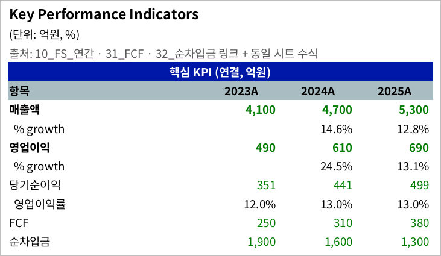
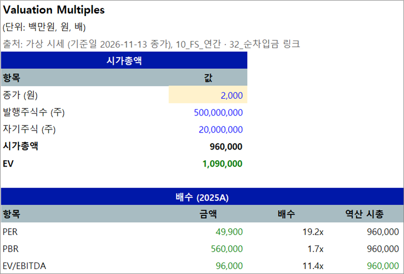
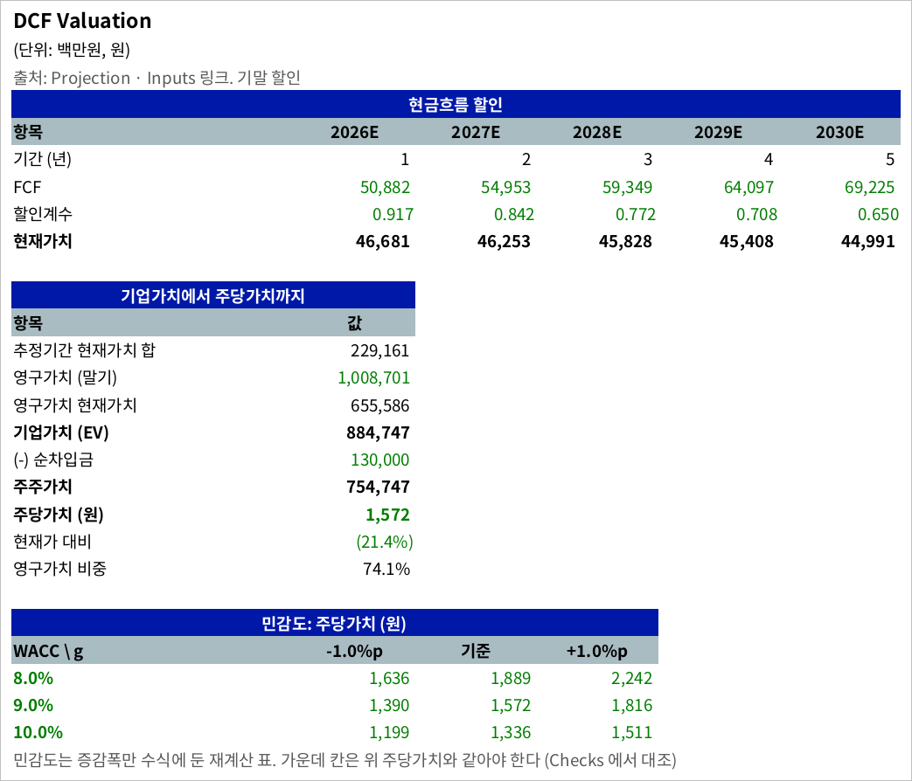
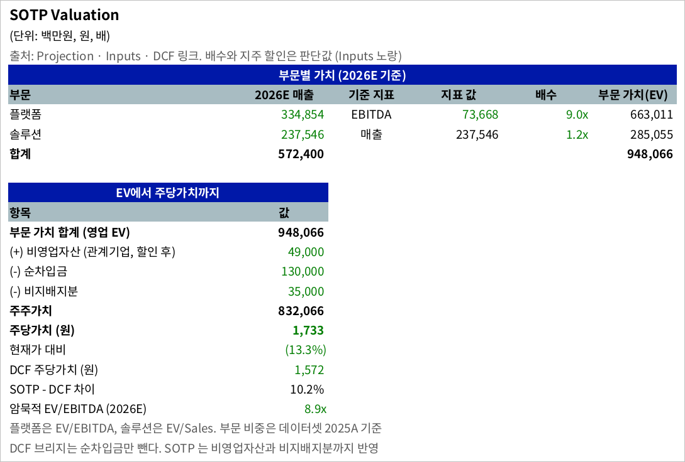

# Claude code - Data 분석 자동화 (Python 기반 Data 자동화 및 Modeling)

[](https://github.com/dhpark19955-code/claude-code-data-portfolio/actions/workflows/ci.yml) 

> AI 에이전트를 지휘해 비정형 공시·IR 원자료를 **검증 가능한 분석용 데이터셋과 재무모델**로 만듭니다.
> 빠르게 만드는 것보다, 틀린 숫자를 걸러내고 같은 결과를 다시 만들 수 있게 하는 데 집중했습니다.

작성자: 박도현 / [dhpark19955@gmail.com](mailto:dhpark19955@gmail.com) 

## 한눈에 보기

이 저장소는 두 파트로 나뉩니다. 데이터셋은 숫자만 담고, 밸류에이션 판단은 모델에서 따로 합니다.

| 파트 | 하는 일 | 결과물 |
|---|---|---|
| [1. Dataset](#1-dataset---공시ir-원자료를-검증된-데이터셋으로) | 공시·IR 원자료 수집 → 전처리·감사 → IB 양식 데이터셋 | [finprep](src/finprep/) 패키지, [sample_dataset_ib.xlsx](examples/dataset/sample_dataset_ib.xlsx) (10시트) |
| [2. Modeling](#2-modeling---데이터셋을-입력으로-dcfsotp-모델) | 데이터셋을 입력으로 DCF·SOTP 모델 빌드, 3케이스 독립 재계산 | [sample_model_dcf.xlsx](examples/modeling/sample_model_dcf.xlsx) (6시트) |

| 항목 | 규모 |
|---|---|
| 기업 데이터셋 | 18개사 (국내 상장 12, 해외 상장 4, 비상장 2. 2026-11 기준 보관본) |
| 표준 데이터셋 | 회사당 22개 시트 안팎 (실측 1건: 22개 시트, 수식 673개) |
| finprep 패키지 | 테스트 67개, Windows·Ubuntu x Python 3.10·3.12 CI |
| Claude Code 구성 | 자체 제작 스킬 4종, 서브에이전트 3종 (구현, 단순 작업, 읽기 전용 검수) |


샘플은 모두 가상 회사(데이터셋·모델은 '가온테크', finprep 데모는 가상 5개사) 데이터이고, 코드가 만든 그대로입니다. 셀 글자색은 파랑 = 입력한 원자료, 검정 = 같은 시트 수식, 초록 = 다른 시트 링크입니다.

## 폴더 구조

```
src/finprep/        전처리·감사 패키지
tests/              finprep 테스트 67개
scripts/            샘플 빌드, 검증, 축약 데모, 공개 전 점검
examples/
  dataset/          IB 양식 데이터셋 샘플
    raw/            finprep 데모 원자료 (가상 5개사)
    finprep_output/ finprep 데모 산출물 (tidy, 요약표, 품질 리포트)
    mini_demo/      표준 라이브러리 축약 데모 산출물
  modeling/         DCF·SOTP 모델 샘플
  verify_report.md  샘플 2종 검증 결과
docs/               상세 문서, 함정 목록, 설정 예시, 화면 캡처
originals/          실사용 파이프라인 모듈과 Claude Code 설정 원본
```

## 1. Dataset - 공시·IR 원자료를 검증된 데이터셋으로

### 바로 실행해 보기 (키, 네트워크 불필요)

```bash
git clone https://github.com/dhpark19955-code/claude-code-data-portfolio
cd claude-code-data-portfolio
pip install -e ".[dev]"
python -m finprep demo     # 가상 원자료 2,679행 -> 분기 tidy 데이터 -> 감사 37건
python -m pytest           # 테스트 67개
python -I -X utf8 scripts/preprocess_demo.py   # 표준 라이브러리만 쓰는 축약판 (규칙 5개, 감사 7항목)
```

```
rows=2679 companies=5 checks=37 pass=35 fail=0 warn=2
  확인 필요: 마루에너지 2024.3Q: 직전 분기 보고서가 없어 분기값 27행을 비워 둠
  확인 필요: 마루에너지: 차입금 별칭 누락 의심 - 유동성 차입금 및 사채
```

경고 2건은 일부러 심어 둔 함정을 잡은 것입니다. 결과물: [품질 리포트](examples/dataset/finprep_output/quality_report.md) / [분기 요약표](examples/dataset/finprep_output/summary_quarterly.csv) / [원자료](examples/dataset/raw/raw_fnltt.csv)

### finprep - 전처리 패키지

[originals/pipeline/](originals/pipeline/) 의 실사용 코드에서 전처리와 감사 부분을 떼어 내 다시 쓴 패키지입니다. 가상 5개사에는 부호 관행 차이, 계정명 변형, 손익·포괄손익 분리, 반기보고서 누락, 별칭 표에 없는 차입금 같은 함정을 회사마다 다르게 심었습니다.

| 모듈 | 하는 일 |
|---|---|
| [clean/parse.py](src/finprep/clean/parse.py) | `(1,234)`·`-`·빈 칸 파싱, 계정명 정리 |
| [clean/aliases.py](src/finprep/clean/aliases.py) | 계정명 변형 -> 표준 계정 31개 |
| [clean/signs.py](src/finprep/clean/signs.py) | 현금흐름 부호 관행 감지·통일 |
| [clean/periods.py](src/finprep/clean/periods.py) | 누적 -> 3개월 차분, 4분기 합성 |
| [clean/units.py](src/finprep/clean/units.py) | 단위 환산 (모르는 단위는 멈춤) |
| [audit/checks.py](src/finprep/audit/checks.py) | 항등식, 교차검증, 부호, 차입금 누수, 범위, 연속성, 부문합 |
| [sample.py](src/finprep/sample.py) | 함정을 심은 가상 5개사 원자료 |
| [fetch/dart.py](src/finprep/fetch/dart.py) | OpenDART 수집 (`python -m finprep fetch <종목코드>`, `DART_API_KEY`) |

테스트는 규칙별 단위 테스트와 오류 주입 테스트([tests/test_audit.py](tests/test_audit.py))로 나뉘고, CI 는 커밋된 샘플 산출물이 코드로 다시 만든 결과와 같은지도 검사합니다.

### 데이터셋 결과물

[sample_dataset_ib.xlsx](examples/dataset/sample_dataset_ib.xlsx): 10시트(00_README, 01_KPI, 10_FS_연간, 11_IS_분기, 15_재무비율, 20_밸류에이션, 30_매출구성, 31_FCF, 32_순차입금, 99_Check), 오류 셀 0개, 점검 17개 전부 PASS. 샘플 수치는 '가온테크' 2025A, 단위 백만원입니다.

| 항목 | 시트 | 샘플 수치 | 자동화 |
|---|---|---|---|
| 부문·제품 매출 | 30_매출구성 | 530,000, 연결과 차이 0 | 반자동 |
| 지역 매출 | 30_매출구성 | 해외 비중 24.5% | 반자동 |
| FCF | 31_FCF | 38,000, FCF 마진 7.2% | 자동 |
| 순차입금 | 32_순차입금 | 130,000, 순차입금/EBITDA 1.4x | 자동 |
| EV | 20_밸류에이션 | 1,055,000 | 자동 |
| 배수와 역산 | 20_밸류에이션, 99_Check | PER 20.2x, EV/EBITDA 11.0x, 역산 시가총액 960,000 | 자동 |

| 데이터셋: KPI | 데이터셋: EV 산출과 배수 역산 |
|---|---|
|  |  |

원천은 공시 API(OpenDART), 네이버 증권 시세, KOSIS, SEC EDGAR 등 해외 공시, 회사 IR 자료이며 모두 공개 자료입니다(엔드포인트와 정의는 [데이터 원천 문서](docs/08_data_sources.md)).

문서: [전처리](docs/01_preprocessing.md) · [비정형 원자료](docs/02_unstructured_parsing.md) · [검증 체계](docs/03_audit.md) · [IB 양식 규격](docs/06_ib_format_spec.md) · [데이터 원천](docs/08_data_sources.md)

## 2. Modeling - 데이터셋을 입력으로 DCF·SOTP 모델

[sample_model_dcf.xlsx](examples/modeling/sample_model_dcf.xlsx): 6시트(Cover, Inputs, Projection, DCF, SOTP, Checks). 입력은 Inputs 한 곳에만 있고, Cover 의 스위치 한 칸으로 Base, Bull, Bear 가 바뀝니다.

| 케이스 | DCF | SOTP | 독립 재계산 차이 | Master check |
|---|---|---|---|---|
| Base | 1,572원 | 1,733원 | 0 | PASS |
| Bull | 2,105원 | 1,807원 | 0 | PASS |
| Bear | 1,076원 | 1,660원 | 0 | PASS |

SOTP 는 비영업자산과 비지배지분까지 반영하고 DCF 브리지는 순차입금만 빼므로, 두 값의 차이는 방법과 가정의 차이로 함께 보고합니다. 결과 원문: [검증 리포트](examples/verify_report.md)

| 모델: DCF | 모델: SOTP |
|---|---|
|  |  |

```bash
python -I -X utf8 scripts/build_ib_sample.py     # 데이터셋 10시트와 모델 6시트 생성 (openpyxl)
python -I -X utf8 scripts/verify_sample_lo.py    # LibreOffice 로 재계산·검증. Excel 환경은 verify_sample.py
```

문서: [모델 빌드](docs/07_model_build.md) · [IB 양식 규격](docs/06_ib_format_spec.md)

## 공통: Claude Code 운영과 원본

- [설정 상세](docs/05_setup_detail.md) · [Claude Code 운영](docs/04_claude_code_ops.md) · [함정 목록](docs/pitfalls.md) · [설정 예시](docs/claude-setup/) · [원본 코드와 설정](originals/) · 공개 전 점검 [scripts/prepublish_scan.py](scripts/prepublish_scan.py)

[originals/](originals/) 에는 실제 쓰는 파이프라인 핵심 모듈 10개와 Claude Code 설정 원본을 개인 PC 경로, 드라이브 폴더 이름, 키 파일 위치를 자리표시자로 바꿔 실었습니다([바꾼 점](originals/README.md)). 키 로더와 회사별 빌드 스크립트는 싣지 않아 그대로는 끝까지 돌지 않으며, 실행해 볼 수 있는 예시는 데모와 가상 데이터 샘플입니다.

### 일하는 원칙

- 분석은 사실(출처), 계산(산식), 추론(라벨)으로 나눠 씁니다.
- 보고는 확인한 것 / 발견한 위험 / 확인 못 한 것 / 정정한 것으로 나눕니다.
- 키와 비밀값은 코드와 출력에 남기지 않고, 삭제·외부 전송·배포는 사람 확인을 거칩니다.
- 로그인 벽과 봇 차단은 우회하지 않고 공개 대체 출처를 씁니다.
