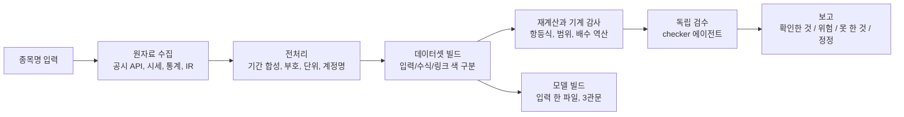

# 공시·IR 원자료를 검증 가능한 데이터셋과 모델로 - Claude Code 운영 포트폴리오

[](https://github.com/dhpark19955-code/claude-code-data-portfolio/actions/workflows/ci.yml) 

> AI 에이전트를 지휘해 비정형 공시·IR 원자료를 **검증 가능한 분석용 데이터셋과 재무모델**로 만듭니다.
> 빠르게 만드는 것보다, 틀린 숫자를 걸러내고 같은 결과를 다시 만들 수 있게 하는 데 집중했습니다.

작성자: 박도현 / [dhpark19955@gmail.com](mailto:dhpark19955@gmail.com) / 투자·FP&A 실무

## 한눈에 보기

| 항목 | 규모 | 비고 |
|---|---|---|
| 기업 데이터셋 | 18개사 | 국내 상장 12, 해외 상장 4, 비상장 2 (2026-11 기준 보관본) |
| 표준 데이터셋 | 회사당 22개 시트 안팎 | 실측 1건: 22개 시트, 수식 673개, 원자료 층과 계산 층 분리 |
| 자체 제작 스킬 | 4종 | 데이터셋 빌드, 원자료 수집, 모델 빌더, 주간 작업기록 |
| 서브에이전트 | 3종 | worker(구현), helper(단순 작업), checker(읽기 전용 검수) |
| 누적 작업 메모 | 149건 | 함정, 결정 사항, 출처 경로를 세션 간에 유지 |
| 실행 가능한 패키지 | finprep, 테스트 67개 | Windows·Ubuntu x Python 3.10·3.12 CI |

## 바로 실행해 보기 (키, 네트워크 불필요)

```bash
git clone https://github.com/dhpark19955-code/claude-code-data-portfolio
cd claude-code-data-portfolio
pip install -e ".[dev]"
python -m finprep demo     # 가상 원자료 2,679행 -> 분기 tidy 데이터 -> 감사 37건
python -m pytest           # 테스트 67개
```

```
rows=2679 companies=5 checks=37 pass=35 fail=0 warn=2
  확인 필요: 마루에너지 2024.3Q: 직전 분기 보고서가 없어 분기값 27행을 비워 둠
  확인 필요: 마루에너지: 차입금 별칭 누락 의심 - 유동성 차입금 및 사채
```

경고 2건은 일부러 심어 둔 함정을 잡은 것입니다. 결과물: [품질 리포트](reports/sample/quality_report.md) / [분기 요약표](reports/sample/summary_quarterly.csv) / [원자료](data/sample/raw_fnltt.csv)

### finprep - 전처리 패키지

`originals/pipeline/` 의 실사용 코드에서 전처리와 감사 부분을 떼어 내, 누구나 끝까지 돌릴 수 있는 패키지로 다시 썼습니다.

| 모듈 | 하는 일 | 원본 |
|---|---|---|
| [clean/parse.py](src/finprep/clean/parse.py) | `(1,234)`·`-`·빈 칸 파싱 (빈 칸을 0 으로 바꾸지 않음), 계정명 머리표·주석 제거, 동명 계정 `#2` | `dart_listed_fs.py` |
| [clean/aliases.py](src/finprep/clean/aliases.py) | 계정명 변형 -> 표준 계정 31개, IS·CIS 중복 정리, 별칭 없는 차입금 경고 | `fs_summary.py` |
| [clean/signs.py](src/finprep/clean/signs.py) | 현금흐름 유출 계정 부호 관행을 회사별로 감지해 통일 (`abs()` 미사용) | 신규 |
| [clean/periods.py](src/finprep/clean/periods.py) | 누적 -> 3개월 차분, 4분기 = 연간 - 3분기 누적, 직전 분기 누락 시 빈 값 + 표시 | `dart_listed_fs.py` |
| [clean/units.py](src/finprep/clean/units.py) | 단위 환산 (주당 금액 제외), 출처 단위 변환 (모르는 단위는 멈춤) | `dart_listed_fs.py` |
| [audit/checks.py](src/finprep/audit/checks.py) | 항등식 3종, 3개월치 교차검증, CAPEX 부호, 차입금 누수, 비율 범위, 분기 연속성, 부문합 | `dataset_audit.py` |
| [sample.py](src/finprep/sample.py) | 공시 API 응답과 같은 모양의 가상 5개사 원자료 (회사마다 다른 함정을 심음) | 신규 |
| [fetch/dart.py](src/finprep/fetch/dart.py) | OpenDART 수집 (`DART_API_KEY` 환경변수, `pip install -e ".[dart]"`) | `dart_listed_fs.py` |

가상 회사별로 심은 함정:

| 회사 | 함정 | 처리 |
|---|---|---|
| 가온테크 | 유출 계정 양수 표기 | 부호 반전 |
| 누리소프트 | 차입금 계정명 변형, 2025년부터 `영업이익(손실)` 로 표기 변경, 일부 표준코드 미사용 | 별칭, 표준코드 키 |
| 다온바이오 | 유출 계정 음수 표기(반대 관행), 유동·비유동 모두 `차입금` | 관행 감지, 순서로 구분 |
| 라온리테일 | 손익·포괄손익 분리, 로마숫자 머리표, `자산 총계` 띄어쓰기 | IS 우선, 이름 정리 |
| 마루에너지 | 2024 반기보고서 누락, 별칭 표에 없는 차입금 | 빈 값 + 경고 |

테스트는 규칙별 단위 테스트와 **오류 주입 테스트**로 나뉩니다. 정상 데이터에 항등식 깨짐, 누적 필드 혼재, 부호 혼재, 차입금 누수, 단위 100배 오류를 하나씩 심고 해당 점검이 실패하는지 확인합니다 ([tests/test_audit.py](tests/test_audit.py)). CI 는 Windows·Ubuntu x Python 3.10·3.12 에서 린트, 테스트, 데모를 돌리고, 커밋된 샘플 산출물이 코드로 다시 만든 결과와 같은지 검사합니다.

## 결과물은 이렇게 나옵니다

가상 회사 샘플입니다. 사람이 다듬지 않고 코드가 만든 그대로입니다.

| 데이터셋: KPI 시트 | 모델: DCF 시트 |
|---|---|
|  |  |

- 파랑은 입력한 원자료, 검정은 같은 시트 수식, 초록은 다른 시트 링크입니다. 셀을 누르지 않아도 숫자의 출처가 보입니다.
- 모델은 스위치 한 칸으로 Base, Bull, Bear가 바뀌고, 세 케이스 모두 엑셀과 무관한 독립 재계산과 대조했습니다.

파일: [sample_dataset_ib.xlsx](demo/output/sample_dataset_ib.xlsx) / [sample_model_dcf.xlsx](demo/output/sample_model_dcf.xlsx) / [검증 리포트](demo/output/verify_report.md)

## 작업 흐름



## 문서

**상세 (먼저 보실 것)**

| 주제 | 내용 | 문서 |
|---|---|---|
| 설정 상세 | 전역 지침 8개 절, 스킬 구성, 에이전트 3종 정의, 메모리 형식 | [docs/05_setup_detail.md](docs/05_setup_detail.md) |
| IB 양식 규격 | 색, 시트 골격, 숫자 형식, 시트 번호 체계, 파일 안의 검증 | [docs/06_ib_format_spec.md](docs/06_ib_format_spec.md) |
| 모델 빌드 | 표준 흐름, 워크북 구조, 3관문, 하지 않는 것 | [docs/07_model_build.md](docs/07_model_build.md) |

**사례**

| # | 주제 | 문서 |
|---|---|---|
| 1 | 전처리 파이프라인 | [docs/01_preprocessing.md](docs/01_preprocessing.md) |
| 2 | 비정형·해외 원자료 | [docs/02_unstructured_parsing.md](docs/02_unstructured_parsing.md) |
| 3 | 검증 체계와 실제로 잡은 오류 | [docs/03_audit.md](docs/03_audit.md) |
| 4 | Claude Code 운영 | [docs/04_claude_code_ops.md](docs/04_claude_code_ops.md) |

**원본**: [originals/](originals/) 실제 파이프라인 모듈 10개와 Claude Code 설정 ([설명](originals/README.md))

부록: [함정 목록](pitfalls.md) / [설정 예시](claude-setup/)

## 데모 실행

| 스크립트 | 하는 일 | 필요한 것 |
|---|---|---|
| `python -m finprep demo` | 가상 5개사 원자료 정리, 감사 37건, 리포트 | pandas |
| `python -m finprep fetch <종목코드>` | 실제 공시 수집 후 같은 흐름 | requests, `DART_API_KEY` |
| [demo/preprocess_demo.py](demo/preprocess_demo.py) | 전처리 규칙 5개와 감사 7항목 | 파이썬만 |
| [demo/build_ib_sample.py](demo/build_ib_sample.py) | IB 양식 데이터셋 8시트, DCF 모델 5시트 생성 | openpyxl |
| [demo/verify_sample.py](demo/verify_sample.py) | Excel 재계산, 오류 셀 수, 3케이스 독립 재계산, 화면 캡처 | Windows, Excel, pywin32 |
| [tools/prepublish_scan.py](tools/prepublish_scan.py) | 공개 전 비밀값·경로·금지어 점검 | 파이썬만 |

```bash
python -I -X utf8 demo/build_ib_sample.py
```

## 원본 코드와 설정

실제 쓰고 있는 파이프라인 핵심 모듈 10개와 Claude Code 설정(전역 지침, 스킬 3종, 에이전트 3종) 원본을 [originals/](originals/) 에 실었습니다. 개인 PC 경로, 드라이브 폴더 이름, 키 파일 위치는 자리표시자로 바꿨고, 바꾼 점은 [originals/README.md](originals/README.md) 에 적었습니다. 공개 공시 API와 공개 시세만 씁니다.

싣지 않은 것은 키 로더, 회사별 빌드 스크립트, 데이터셋 원본 파일, 작업기록 스킬입니다. 그래서 `run_pipeline.py` 는 그대로는 끝까지 돌지 않습니다. 같은 양식으로 실행해 볼 수 있는 예시는 데모와 가상 데이터 샘플입니다. 실측 수치(시트 수, 수식 수 등)는 원본을 열어 센 값입니다.

## 일하는 원칙

- 분석은 사실(출처 명시), 계산(산식 표기), 추론(라벨 표기)으로 나눠 씁니다.
- 보고는 "확인한 것 / 발견한 위험 / 확인 못 한 것 / 정정한 것"으로 나눕니다. 근거 없이 "문제없다"로 끝내지 않습니다.
- 키와 비밀값은 코드와 출력에 남기지 않습니다. 삭제, 외부 전송, 배포는 사람 확인을 거칩니다.
- 로그인 벽과 봇 차단은 우회하지 않고 공개 대체 출처를 씁니다.
