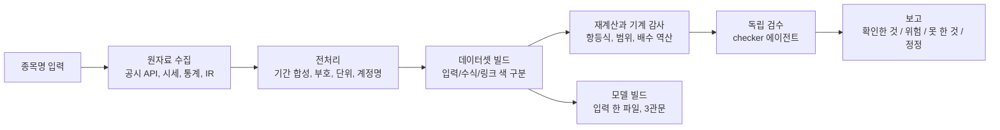

# 공시·IR 원자료를 검증 가능한 데이터셋과 모델로 - Claude Code 운영 포트폴리오

> AI 에이전트를 지휘해 비정형 공시·IR 원자료를 **검증 가능한 분석용 데이터셋과 재무모델**로 만듭니다.
> 빠르게 만드는 것보다, 틀린 숫자를 걸러내고 같은 결과를 다시 만들 수 있게 하는 데 집중했습니다.

작성자: 박도현 / [dhpark19955@gmail.com](mailto:dhpark19955@gmail.com) / 투자·FP&A 실무

## 한눈에 보기

| 항목 | 규모 | 비고 |
|---|---|---|
| 기업 데이터셋 | 18개사 | 국내 상장 12, 해외 상장 4, 비상장 2 (2026-11 기준 보관본) |
| 표준 데이터셋 | 회사당 22개 시트 안팎 | 실측 1건: 22개 시트, 수식 673개, 원자료 층과 계산 층 분리 |
| 자체 제작 스킬 | 4종 | 데이터셋 빌드, 원자료 수집, 모델 빌더, 주간 작업기록 |
| 서브에이전트 | 3종 | worker(구현), helper(단순 작업), checker(읽기 전용 검수) |
| 누적 작업 메모 | 149건 | 함정, 결정 사항, 출처 경로를 세션 간에 유지 |

## 결과물은 이렇게 나옵니다

가상 회사 샘플입니다. 사람이 다듬지 않고 코드가 만든 그대로입니다.

| 데이터셋: KPI 시트 | 모델: DCF 시트 |
|---|---|
|  |  |

- 파랑은 입력한 원자료, 검정은 같은 시트 수식, 초록은 다른 시트 링크입니다. 셀을 누르지 않아도 숫자의 출처가 보입니다.
- 모델은 스위치 한 칸으로 Base, Bull, Bear가 바뀌고, 세 케이스 모두 DCF와 SOTP 주당가치를 엑셀과 무관한 독립 재계산과 대조했습니다.

| 파일 | 시트 | 검증 결과 |
|---|---|---|
| [sample_dataset_ib.xlsx](demo/output/sample_dataset_ib.xlsx) | 10개: 00_README, 01_KPI, 10_FS_연간, 11_IS_분기, 15_재무비율, 20_밸류에이션, 30_매출구성, 31_FCF, 32_순차입금, 99_Check | 오류 셀 0개, 점검 17개 전부 PASS. 단위 백만원(KPI만 억원) |
| [sample_model_dcf.xlsx](demo/output/sample_model_dcf.xlsx) | 6개: Cover, Inputs, Projection, DCF, SOTP, Checks | Base, Bull, Bear 3케이스 전부 PASS |

검증 결과 원문: [검증 리포트](demo/output/verify_report.md)

## 무엇을 구할 수 있나

데이터셋은 재무제표에서 끝나지 않고 매출 세부, FCF, 순차입금, EV까지 구합니다. SOTP는 데이터셋 밖의 별도 모델에서 만듭니다. 샘플 수치는 가상 회사 '가온테크'의 2025A(SOTP는 2026E Base) 값이고 단위는 백만원입니다.

| 항목 | 담기는 시트 | 샘플 수치 | 자동화 범위 |
|---|---|---|---|
| 부문·제품 매출 | 30_매출구성 | 플랫폼 310,000 / 솔루션 220,000 / 기타 6,000 / 내부거래 제거 (6,000) = 530,000. 연결 매출과 차이 0. 부문 영업이익 합 69,000 = 연결 영업이익. 플랫폼 비중 58.5% | 반자동. 원문 수집은 자동, 사업보고서 XML 표 해석은 회사별 작업이라 파이프라인 7단계 체크리스트에 수작업 항목으로 나옴 |
| 지역 매출 | 30_매출구성 | 국내 400,000 / 해외 130,000. 해외 비중 24.5% | 반자동. 위와 같음 |
| FCF | 31_FCF | 영업활동현금흐름 86,000 + 유형자산 취득 (41,000) + 무형자산 취득 (7,000) = 38,000. FCF 마진 7.2%, 현금전환율 79.8%, 배당 후 FCF 24,000, FCF yield 4.0% | 자동. 다만 CAPEX 수집 스크립트(`fetch_capex.py`)는 이 저장소에 없음 |
| 순차입금·순현금 | 32_순차입금 | 총차입금 240,000 − 현금 110,000 = 순차입금 130,000. 리스 포함 155,000. 순현금 (130,000). 순차입금/EBITDA 1.4x | 자동. 차입금 별칭 누락은 경고로 잡음 |
| EV 산출 | 20_밸류에이션 | 시가총액 960,000 + 순차입금 130,000 + 비지배지분 35,000 − 관계기업투자 70,000 = EV 1,055,000 | 자동 (시트 수식) |
| 배수와 역산 | 20_밸류에이션, 99_Check | PER 20.2x, PBR 1.8x, EV/EBITDA 11.0x, EV/Sales 2.0x. 네 배수 모두 역산하면 시가총액 960,000 | 자동 (시트 수식과 감사 도구) |
| SOTP | 모델의 SOTP 시트 | 플랫폼 663,011 + 솔루션 285,055 = 영업 EV 948,066 → 주당가치 1,733원 (DCF 1,572원) | 데이터셋 밖의 별도 모델 워크플로우. 부문 배수와 할인율은 사람이 정하는 판단값 |

- 순차입금은 양수면 순차입, 음수면 순현금입니다. 리스부채는 기본 순차입금에서 빼고 '리스 포함' 행에만 더합니다.
- FCF의 CAPEX는 유출이라 음수로 저장하고, FCF = 영업활동현금흐름 + 유형 + 무형으로 더합니다.
- 각 항목의 원천, 계산 방법, 정의는 [데이터 원천 문서](docs/08_data_sources.md) 에 있습니다.

| 데이터셋: 매출 구성 | 데이터셋: FCF |
|---|---|
|  |  |

| 데이터셋: 순차입금 | 데이터셋: EV 산출과 배수 역산 |
|---|---|
|  |  |

| 모델: SOTP |
|---|
|  |

## 사용하는 API

원천은 모두 공개 자료입니다. 키는 환경변수나 키 파일에서 읽고 코드에 적지 않습니다. 엔드포인트별 파라미터, 받는 것, 코드 위치, 막힌 경로와 대체는 [docs/08_data_sources.md](docs/08_data_sources.md) 에 있습니다.

| 원천 | 주요 엔드포인트 | 받는 것 | 키 |
|---|---|---|---|
| 공시 API (OpenDART) | `fnlttSinglAcntAll.json`, `stockTotqySttus.json`, `majorstock.json`, `elestock.json`, `alotMatter`, `hyslrSttus`, `tesstkAcqsDspsSttus`, `corpCode.xml`, `document.xml` | 재무제표 전 계정(현금흐름표의 CAPEX 줄 포함), 주식 총수, 지분 보고, 배당, 자기주식, 공시 원문 | DART |
| 시세 (네이버 증권 JSON) | `polling.finance.naver.com/api/realtime/domestic/stock/{code}`, `m.stock.naver.com/api/stock/{code}/integration`, `api.stock.naver.com/chart/domestic/item/{code}/day`, `fchart.stock.naver.com/siseJson.naver`, `m.stock.naver.com/api/stock/{code}/trend`, `m.stock.naver.com/api/stock/{code}/finance/annual` · `/finance/quarter` | 종가, 시총·투자지표, 일별 시세, 투자자별 수급, 재무요약·컨센서스 | 없음 |
| 통계 (KOSIS) | `statisticsParameterData.do`, `getMeta` | 업종 통계 | KOSIS |
| 해외 (SEC EDGAR 등) | SEC companyfacts, XBRL 인스턴스, 20-F·6-K, Form 4, 13F. 유럽은 ESEF `filings.xbrl.org` | 해외 상장사 재무, 내부자 매매, 기관 보유 | SEC_USER_AGENT (SEC만) |
| IR 자료 | 회사 IR 메뉴, 공시 목록의 IR 개최·공정공시, IRGO `m.irgo.co.kr/IR-COMP/<코드>` | IR 덱 KPI | 없음 |

재무제표·주식 총수·지분 보고 수집과 네이버 시세 모듈은 [originals/pipeline/](originals/pipeline/) 에 코드가 있습니다. 배당·자기주식·CAPEX·공시 원문 수집, KOSIS, 해외 원천은 스킬 문서 기준이라 수집 스크립트가 이 저장소에 없습니다.

## 작업 흐름



## 문서

**상세 (먼저 보실 것)**

| 주제 | 내용 | 문서 |
|---|---|---|
| 설정 상세 | 전역 지침 8개 절, 스킬 구성, 에이전트 3종 정의, 메모리 형식 | [docs/05_setup_detail.md](docs/05_setup_detail.md) |
| IB 양식 규격 | 색, 시트 골격, 숫자 형식, 시트 번호 체계, 파일 안의 검증 | [docs/06_ib_format_spec.md](docs/06_ib_format_spec.md) |
| 모델 빌드 | 표준 흐름, 워크북 구조, SOTP, 3관문, 하지 않는 것 | [docs/07_model_build.md](docs/07_model_build.md) |
| 데이터 원천 | 사용하는 API와 엔드포인트, 매출 구성·FCF·순차입금·EV를 구하는 방법과 정의, 막힌 경로와 대체 | [docs/08_data_sources.md](docs/08_data_sources.md) |

**사례**

| # | 주제 | 문서 |
|---|---|---|
| 1 | 전처리 파이프라인 | [docs/01_preprocessing.md](docs/01_preprocessing.md) |
| 2 | 비정형·해외 원자료 | [docs/02_unstructured_parsing.md](docs/02_unstructured_parsing.md) |
| 3 | 검증 체계와 실제로 잡은 오류 | [docs/03_audit.md](docs/03_audit.md) |
| 4 | Claude Code 운영 | [docs/04_claude_code_ops.md](docs/04_claude_code_ops.md) |

**원본**: [originals/](originals/) 실제 파이프라인 모듈 10개와 Claude Code 설정 ([설명](originals/README.md))

부록: [함정 목록](pitfalls.md) / [설정 예시](claude-setup/)

## 데모 실행

| 스크립트 | 하는 일 | 필요한 것 |
|---|---|---|
| [demo/preprocess_demo.py](demo/preprocess_demo.py) | 전처리 규칙 5개와 감사 7항목 | 파이썬만 |
| [demo/build_ib_sample.py](demo/build_ib_sample.py) | IB 양식 데이터셋 10시트, DCF·SOTP 모델 6시트 생성 | openpyxl |
| [demo/verify_sample.py](demo/verify_sample.py) | Excel 재계산, 오류 셀 수, 3케이스 DCF·SOTP 독립 재계산, 화면 캡처 | Windows, Excel, pywin32 |
| [demo/verify_sample_lo.py](demo/verify_sample_lo.py) | 위와 같은 검증을 LibreOffice headless로. 값 계산과 캡처에만 쓰고 배포 xlsx는 openpyxl 원본 그대로 둠 | Linux, macOS, Windows. LibreOffice, openpyxl, poppler, ImageMagick |
| [demo/independent.py](demo/independent.py) | 엑셀 수식과 무관하게 DCF·SOTP 주당가치를 다시 계산. 두 검증기가 같이 씀 | openpyxl |
| [tools/prepublish_scan.py](tools/prepublish_scan.py) | 공개 전 비밀값·경로·금지어 점검 | 파이썬만 |

```bash
python -I -X utf8 demo/build_ib_sample.py
python -I -X utf8 demo/verify_sample_lo.py   # Excel이 없는 환경
```

## 원본 코드와 설정

실제 쓰고 있는 파이프라인 핵심 모듈 10개와 Claude Code 설정(전역 지침, 스킬 3종, 에이전트 3종) 원본을 [originals/](originals/) 에 실었습니다. 개인 PC 경로, 드라이브 폴더 이름, 키 파일 위치는 자리표시자로 바꿨고, 바꾼 점은 [originals/README.md](originals/README.md) 에 적었습니다. 공개 공시 API와 공개 시세만 씁니다.

싣지 않은 것은 키 로더, 회사별 빌드 스크립트, 데이터셋 원본 파일, 작업기록 스킬입니다. 그래서 `run_pipeline.py` 는 그대로는 끝까지 돌지 않습니다. 같은 양식으로 실행해 볼 수 있는 예시는 데모와 가상 데이터 샘플입니다. 실측 수치(시트 수, 수식 수 등)는 원본을 열어 센 값입니다.

## 일하는 원칙

- 분석은 사실(출처 명시), 계산(산식 표기), 추론(라벨 표기)으로 나눠 씁니다.
- 보고는 "확인한 것 / 발견한 위험 / 확인 못 한 것 / 정정한 것"으로 나눕니다. 근거 없이 "문제없다"로 끝내지 않습니다.
- 키와 비밀값은 코드와 출력에 남기지 않습니다. 삭제, 외부 전송, 배포는 사람 확인을 거칩니다.
- 로그인 벽과 봇 차단은 우회하지 않고 공개 대체 출처를 씁니다.
