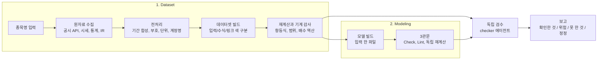
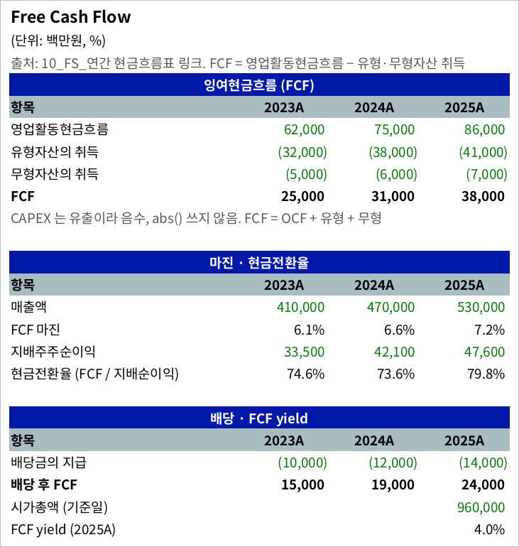
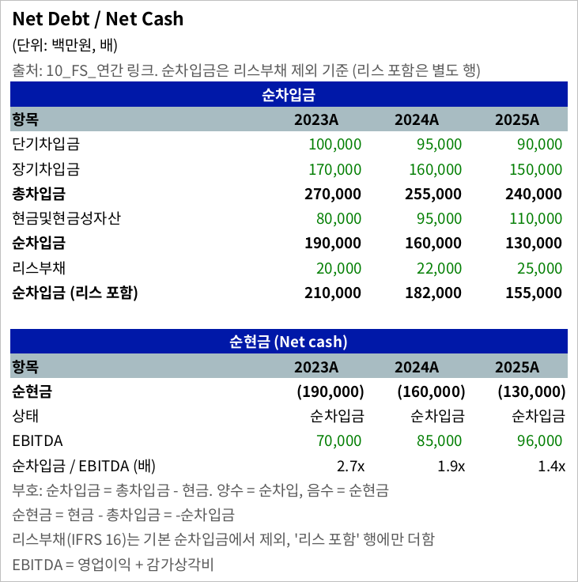

# Claude code - Data 분석 자동화 (Python 기반 Data 자동화 및 Modeling)

[](https://github.com/dhpark19955-code/claude-code-data-portfolio/actions/workflows/ci.yml) 

> AI 에이전트를 지휘해 비정형 공시·IR 원자료를 **검증 가능한 분석용 데이터셋과 재무모델**로 만듭니다.
> 빠르게 만드는 것보다, 틀린 숫자를 걸러내고 같은 결과를 다시 만들 수 있게 하는 데 집중했습니다.

작성자: 박도현 / [dhpark19955@gmail.com](mailto:dhpark19955@gmail.com) 

## 한눈에 보기

이 저장소는 두 파트로 나뉩니다. 데이터셋은 숫자만 담고, 밸류에이션 판단은 모델에서 따로 합니다.

| 파트 | 하는 일 | 결과물 | 상세 문서 |
|---|---|---|---|
| [1. Dataset](#1-dataset---공시ir-원자료를-검증된-데이터셋으로) | 공시·IR 원자료 수집 → 전처리·감사 → IB 양식 데이터셋 | [finprep](src/finprep/) 패키지, [sample_dataset_ib.xlsx](demo/output/sample_dataset_ib.xlsx) (10시트) | [01](docs/01_preprocessing.md), [02](docs/02_unstructured_parsing.md), [03](docs/03_audit.md), [06](docs/06_ib_format_spec.md), [08](docs/08_data_sources.md) |
| [2. Modeling](#2-modeling---데이터셋을-입력으로-dcfsotp-모델) | 데이터셋을 입력으로 DCF·SOTP 모델 빌드, 3케이스 독립 재계산 | [sample_model_dcf.xlsx](demo/output/sample_model_dcf.xlsx) (6시트) | [07](docs/07_model_build.md) |

| 항목 | 규모 | 비고 |
|---|---|---|
| 기업 데이터셋 | 18개사 | 국내 상장 12, 해외 상장 4, 비상장 2 (2026-11 기준 보관본) |
| 표준 데이터셋 | 회사당 22개 시트 안팎 | 실측 1건: 22개 시트, 수식 673개, 원자료 층과 계산 층 분리 |
| 실행 가능한 패키지 | finprep, 테스트 67개 | Windows·Ubuntu x Python 3.10·3.12 CI |
| 자체 제작 스킬 | 4종 | 데이터셋 빌드, 원자료 수집, 모델 빌더, 주간 작업기록 |
| 서브에이전트 | 3종 | worker(구현), helper(단순 작업), checker(읽기 전용 검수) |
| 누적 작업 메모 | 149건 | 함정, 결정 사항, 출처 경로를 세션 간에 유지 |

## 작업 흐름



샘플은 모두 가상 회사(데이터셋·모델은 '가온테크', finprep 데모는 가상 5개사) 데이터이고, 사람이 다듬지 않고 코드가 만든 그대로입니다. 셀 글자색은 두 파트 공통으로 파랑 = 입력한 원자료, 검정 = 같은 시트 수식, 초록 = 다른 시트 링크입니다.

---

## 1. Dataset - 공시·IR 원자료를 검증된 데이터셋으로

### 1-1. 바로 실행해 보기 (키, 네트워크 불필요)

```bash
git clone https://github.com/dhpark19955-code/claude-code-data-portfolio
cd claude-code-data-portfolio
pip install -e ".[dev]"
python -m finprep demo     # 가상 원자료 2,679행 -> 분기 tidy 데이터 -> 감사 37건
python -m pytest           # 테스트 67개
```

```
rows=2679 companies=5 checks=37 pass=35 fail=0 warn=2
  확인 필요: 마루에너지 2024.3Q: 직전 분기 보고서가 없어 분기값 27행을 비워 둠
  확인 필요: 마루에너지: 차입금 별칭 누락 의심 - 유동성 차입금 및 사채
```

경고 2건은 일부러 심어 둔 함정을 잡은 것입니다. 결과물: [품질 리포트](reports/sample/quality_report.md) / [분기 요약표](reports/sample/summary_quarterly.csv) / [원자료](data/sample/raw_fnltt.csv)

### 1-2. finprep - 전처리 패키지

`originals/pipeline/` 의 실사용 코드에서 전처리와 감사 부분을 떼어 내, 누구나 끝까지 돌릴 수 있는 패키지로 다시 썼습니다.

| 모듈 | 하는 일 | 원본 |
|---|---|---|
| [clean/parse.py](src/finprep/clean/parse.py) | `(1,234)`·`-`·빈 칸 파싱 (빈 칸을 0 으로 바꾸지 않음), 계정명 머리표·주석 제거, 동명 계정 `#2` | `dart_listed_fs.py` |
| [clean/aliases.py](src/finprep/clean/aliases.py) | 계정명 변형 -> 표준 계정 31개, IS·CIS 중복 정리, 별칭 없는 차입금 경고 | `fs_summary.py` |
| [clean/signs.py](src/finprep/clean/signs.py) | 현금흐름 유출 계정 부호 관행을 회사별로 감지해 통일 (`abs()` 미사용) | 신규 |
| [clean/periods.py](src/finprep/clean/periods.py) | 누적 -> 3개월 차분, 4분기 = 연간 - 3분기 누적, 직전 분기 누락 시 빈 값 + 표시 | `dart_listed_fs.py` |
| [clean/units.py](src/finprep/clean/units.py) | 단위 환산 (주당 금액 제외), 출처 단위 변환 (모르는 단위는 멈춤) | `dart_listed_fs.py` |
| [audit/checks.py](src/finprep/audit/checks.py) | 항등식 3종, 3개월치 교차검증, CAPEX 부호, 차입금 누수, 비율 범위, 분기 연속성, 부문합 | `dataset_audit.py` |
| [sample.py](src/finprep/sample.py) | 공시 API 응답과 같은 모양의 가상 5개사 원자료 (회사마다 다른 함정을 심음) | 신규 |
| [fetch/dart.py](src/finprep/fetch/dart.py) | OpenDART 수집 (`DART_API_KEY` 환경변수, `pip install -e ".[dart]"`) | `dart_listed_fs.py` |

가상 회사별로 심은 함정:

| 회사 | 함정 | 처리 |
|---|---|---|
| 가온테크 | 유출 계정 양수 표기 | 부호 반전 |
| 누리소프트 | 차입금 계정명 변형, 2025년부터 `영업이익(손실)` 로 표기 변경, 일부 표준코드 미사용 | 별칭, 표준코드 키 |
| 다온바이오 | 유출 계정 음수 표기(반대 관행), 유동·비유동 모두 `차입금` | 관행 감지, 순서로 구분 |
| 라온리테일 | 손익·포괄손익 분리, 로마숫자 머리표, `자산 총계` 띄어쓰기 | IS 우선, 이름 정리 |
| 마루에너지 | 2024 반기보고서 누락, 별칭 표에 없는 차입금 | 빈 값 + 경고 |

테스트는 규칙별 단위 테스트와 **오류 주입 테스트**로 나뉩니다. 정상 데이터에 항등식 깨짐, 누적 필드 혼재, 부호 혼재, 차입금 누수, 단위 100배 오류를 하나씩 심고 해당 점검이 실패하는지 확인합니다 ([tests/test_audit.py](tests/test_audit.py)). CI 는 Windows·Ubuntu x Python 3.10·3.12 에서 린트, 테스트, 데모를 돌리고, 커밋된 샘플 산출물이 코드로 다시 만든 결과와 같은지 검사합니다.

### 1-3. 데이터셋 결과물

| 파일 | 시트 | 검증 결과 |
|---|---|---|
| [sample_dataset_ib.xlsx](demo/output/sample_dataset_ib.xlsx) | 10개: 00_README, 01_KPI, 10_FS_연간, 11_IS_분기, 15_재무비율, 20_밸류에이션, 30_매출구성, 31_FCF, 32_순차입금, 99_Check | 오류 셀 0개, 점검 17개 전부 PASS. 단위 백만원(KPI만 억원) |

| 데이터셋: KPI 시트 |
|---|
|  |

셀을 누르지 않아도 색으로 숫자의 출처가 보입니다. 검증 결과 원문: [검증 리포트](demo/output/verify_report.md)

### 1-4. 데이터셋이 구하는 것

재무제표에서 끝나지 않고 매출 세부, FCF, 순차입금, EV까지 구합니다. 샘플 수치는 가상 회사 '가온테크'의 2025A 값이고 단위는 백만원입니다.

| 항목 | 담기는 시트 | 샘플 수치 | 자동화 범위 |
|---|---|---|---|
| 부문·제품 매출 | 30_매출구성 | 플랫폼 310,000 / 솔루션 220,000 / 기타 6,000 / 내부거래 제거 (6,000) = 530,000. 연결 매출과 차이 0. 부문 영업이익 합 69,000 = 연결 영업이익. 플랫폼 비중 58.5% | 반자동. 원문 수집은 자동, 사업보고서 XML 표 해석은 회사별 작업이라 파이프라인 7단계 체크리스트에 수작업 항목으로 나옴 |
| 지역 매출 | 30_매출구성 | 국내 400,000 / 해외 130,000. 해외 비중 24.5% | 반자동. 위와 같음 |
| FCF | 31_FCF | 영업활동현금흐름 86,000 + 유형자산 취득 (41,000) + 무형자산 취득 (7,000) = 38,000. FCF 마진 7.2%, 현금전환율 79.8%, 배당 후 FCF 24,000, FCF yield 4.0% | 자동. 다만 CAPEX 수집 스크립트(`fetch_capex.py`)는 이 저장소에 없음 |
| 순차입금·순현금 | 32_순차입금 | 총차입금 240,000 − 현금 110,000 = 순차입금 130,000. 리스 포함 155,000. 순현금 (130,000). 순차입금/EBITDA 1.4x | 자동. 차입금 별칭 누락은 경고로 잡음 |
| EV 산출 | 20_밸류에이션 | 시가총액 960,000 + 순차입금 130,000 + 비지배지분 35,000 − 관계기업투자 70,000 = EV 1,055,000 | 자동 (시트 수식) |
| 배수와 역산 | 20_밸류에이션, 99_Check | PER 20.2x, PBR 1.8x, EV/EBITDA 11.0x, EV/Sales 2.0x. 네 배수 모두 역산하면 시가총액 960,000 | 자동 (시트 수식과 감사 도구) |

- 순차입금은 양수면 순차입, 음수면 순현금입니다. 리스부채는 기본 순차입금에서 빼고 '리스 포함' 행에만 더합니다.
- FCF의 CAPEX는 유출이라 음수로 저장하고, FCF = 영업활동현금흐름 + 유형 + 무형으로 더합니다.
- SOTP는 데이터셋이 아니라 [2. Modeling](#2-modeling---데이터셋을-입력으로-dcfsotp-모델)에서 만듭니다.
- 각 항목의 원천, 계산 방법, 정의는 [데이터 원천 문서](docs/08_data_sources.md) 에 있습니다.

| 데이터셋: 매출 구성 | 데이터셋: FCF |
|---|---|
|  |  |

| 데이터셋: 순차입금 | 데이터셋: EV 산출과 배수 역산 |
|---|---|
|  |  |

### 1-5. 사용하는 API

원천은 모두 공개 자료입니다. 키는 환경변수나 키 파일에서 읽고 코드에 적지 않습니다. 엔드포인트별 파라미터, 받는 것, 코드 위치, 막힌 경로와 대체는 [docs/08_data_sources.md](docs/08_data_sources.md) 에 있습니다.

| 원천 | 주요 엔드포인트 | 받는 것 | 키 |
|---|---|---|---|
| 공시 API (OpenDART) | `fnlttSinglAcntAll.json`, `stockTotqySttus.json`, `majorstock.json`, `elestock.json`, `alotMatter`, `hyslrSttus`, `tesstkAcqsDspsSttus`, `corpCode.xml`, `document.xml` | 재무제표 전 계정(현금흐름표의 CAPEX 줄 포함), 주식 총수, 지분 보고, 배당, 자기주식, 공시 원문 | DART |
| 시세 (네이버 증권 JSON) | `polling.finance.naver.com/api/realtime/domestic/stock/{code}`, `m.stock.naver.com/api/stock/{code}/integration`, `api.stock.naver.com/chart/domestic/item/{code}/day`, `fchart.stock.naver.com/siseJson.naver`, `m.stock.naver.com/api/stock/{code}/trend`, `m.stock.naver.com/api/stock/{code}/finance/annual` · `/finance/quarter` | 종가, 시총·투자지표, 일별 시세, 투자자별 수급, 재무요약·컨센서스 | 없음 |
| 통계 (KOSIS) | `statisticsParameterData.do`, `getMeta` | 업종 통계 | KOSIS |
| 해외 (SEC EDGAR 등) | SEC companyfacts, XBRL 인스턴스, 20-F·6-K, Form 4, 13F. 유럽은 ESEF `filings.xbrl.org` | 해외 상장사 재무, 내부자 매매, 기관 보유 | SEC_USER_AGENT (SEC만) |
| IR 자료 | 회사 IR 메뉴, 공시 목록의 IR 개최·공정공시, IRGO `m.irgo.co.kr/IR-COMP/<코드>` | IR 덱 KPI | 없음 |

재무제표·주식 총수·지분 보고 수집과 네이버 시세 모듈은 [originals/pipeline/](originals/pipeline/) 에 코드가 있습니다. 배당·자기주식·CAPEX·공시 원문 수집, KOSIS, 해외 원천은 스킬 문서 기준이라 수집 스크립트가 이 저장소에 없습니다.

### 1-6. 실행 스크립트

| 스크립트 | 하는 일 | 필요한 것 |
|---|---|---|
| `python -m finprep demo` | 가상 5개사 원자료 정리, 감사 37건, 리포트 | pandas |
| `python -m finprep fetch <종목코드>` | 실제 공시 수집 후 같은 흐름 | requests, `DART_API_KEY` |
| [demo/preprocess_demo.py](demo/preprocess_demo.py) | 전처리 규칙 5개와 감사 7항목 (표준 라이브러리만 쓰는 축약판) | 파이썬만 |
| [demo/build_ib_sample.py](demo/build_ib_sample.py) | IB 양식 데이터셋 10시트 생성 (같은 스크립트가 2. Modeling 의 모델도 만듦) | openpyxl |

### 1-7. 문서

| 주제 | 내용 | 문서 |
|---|---|---|
| 데이터 원천 | 사용하는 API와 엔드포인트, 매출 구성·FCF·순차입금·EV를 구하는 방법과 정의, 막힌 경로와 대체 | [docs/08_data_sources.md](docs/08_data_sources.md) |
| IB 양식 규격 | 색, 시트 골격, 숫자 형식, 시트 번호 체계, 파일 안의 검증 | [docs/06_ib_format_spec.md](docs/06_ib_format_spec.md) |
| 사례: 전처리 파이프라인 | 기간, 부호, 단위, 계정명 규칙 | [docs/01_preprocessing.md](docs/01_preprocessing.md) |
| 사례: 비정형·해외 원자료 | 공시 원문, XBRL, 실적발표 HTML 표, IR PDF | [docs/02_unstructured_parsing.md](docs/02_unstructured_parsing.md) |
| 사례: 검증 체계 | 감사 항목과 실제로 잡은 오류 | [docs/03_audit.md](docs/03_audit.md) |

---

## 2. Modeling - 데이터셋을 입력으로 DCF·SOTP 모델

### 2-1. 모델 결과물

| 파일 | 시트 | 검증 결과 |
|---|---|---|
| [sample_model_dcf.xlsx](demo/output/sample_model_dcf.xlsx) | 6개: Cover, Inputs, Projection, DCF, SOTP, Checks | Base, Bull, Bear 3케이스 전부 PASS |

- 입력은 Inputs 시트 한 곳에만 있고, 계산 시트는 수식만 씁니다. Inputs 의 근거 열이 데이터셋의 30_매출구성, 32_순차입금, 10_FS_연간을 가리킵니다.
- 스위치 한 칸(Cover)으로 Base, Bull, Bear가 바뀌고, 세 케이스 모두 DCF와 SOTP 주당가치를 엑셀과 무관한 독립 재계산과 대조했습니다.
- WACC, 영구성장률, 부문 배수, 지주 할인은 사람이 정하는 판단값입니다.

| 모델: Inputs 시트 | 모델: DCF 시트 |
|---|---|
|  |  |

### 2-2. DCF·SOTP 결과 (가상 데이터, 주당가치)

| 케이스 | DCF | SOTP | 엑셀 값과 독립 재계산 차이 | Master check |
|---|---|---|---|---|
| Base | 1,572원 | 1,733원 | 0 | PASS |
| Bull | 2,105원 | 1,807원 | 0 | PASS |
| Bear | 1,076원 | 1,660원 | 0 | PASS |

SOTP (2026E Base, 백만원): 플랫폼 663,011 + 솔루션 285,055 = 영업 EV 948,066 → 주당가치 1,733원. DCF 브리지는 순차입금만 빼고 SOTP 는 비영업자산과 비지배지분까지 반영하므로, 두 값의 차이는 방법과 가정의 차이로 함께 보고합니다. 결과 원문: [검증 리포트](demo/output/verify_report.md)

| 모델: SOTP |
|---|
|  |

### 2-3. 빌드·검증 스크립트

| 스크립트 | 하는 일 | 필요한 것 |
|---|---|---|
| [demo/build_ib_sample.py](demo/build_ib_sample.py) | IB 양식 데이터셋 10시트, DCF·SOTP 모델 6시트 생성 | openpyxl |
| [demo/verify_sample.py](demo/verify_sample.py) | Excel 재계산, 오류 셀 수, 3케이스 DCF·SOTP 독립 재계산, 화면 캡처 | Windows, Excel, pywin32 |
| [demo/verify_sample_lo.py](demo/verify_sample_lo.py) | 위와 같은 검증을 LibreOffice headless로. 값 계산과 캡처에만 쓰고 배포 xlsx는 openpyxl 원본 그대로 둠 | Linux, macOS, Windows. LibreOffice, openpyxl, poppler, ImageMagick |
| [demo/independent.py](demo/independent.py) | 엑셀 수식과 무관하게 DCF·SOTP 주당가치를 다시 계산. 두 검증기가 같이 씀 | openpyxl |

```bash
python -I -X utf8 demo/build_ib_sample.py
python -I -X utf8 demo/verify_sample_lo.py   # Excel이 없는 환경
```

### 2-4. 문서

| 주제 | 내용 | 문서 |
|---|---|---|
| 모델 빌드 | 표준 흐름, 워크북 구조, SOTP, 3관문, 하지 않는 것 | [docs/07_model_build.md](docs/07_model_build.md) |
| IB 양식 규격 | 색, 시트 골격, 숫자 형식 (데이터셋과 공통) | [docs/06_ib_format_spec.md](docs/06_ib_format_spec.md) |

---

## 공통: Claude Code 운영과 원본

| 주제 | 내용 | 문서 |
|---|---|---|
| 설정 상세 | 전역 지침 8개 절, 스킬 구성, 에이전트 3종 정의, 메모리 형식 | [docs/05_setup_detail.md](docs/05_setup_detail.md) |
| Claude Code 운영 | 지침 라우팅, 지휘자·일꾼·점검자 분업, 실패 메모 | [docs/04_claude_code_ops.md](docs/04_claude_code_ops.md) |
| 공개 전 점검 | 비밀값·경로·금지어 점검 ([tools/prepublish_scan.py](tools/prepublish_scan.py), 파이썬만) | - |

부록: [함정 목록](pitfalls.md) / [설정 예시](claude-setup/)

### 원본 코드와 설정

실제 쓰고 있는 파이프라인 핵심 모듈 10개와 Claude Code 설정(전역 지침, 스킬 3종, 에이전트 3종) 원본을 [originals/](originals/) 에 실었습니다. 개인 PC 경로, 드라이브 폴더 이름, 키 파일 위치는 자리표시자로 바꿨고, 바꾼 점은 [originals/README.md](originals/README.md) 에 적었습니다. 공개 공시 API와 공개 시세만 씁니다.

싣지 않은 것은 키 로더, 회사별 빌드 스크립트, 데이터셋 원본 파일, 작업기록 스킬입니다. 그래서 `run_pipeline.py` 는 그대로는 끝까지 돌지 않습니다. 같은 양식으로 실행해 볼 수 있는 예시는 데모와 가상 데이터 샘플입니다. 실측 수치(시트 수, 수식 수 등)는 원본을 열어 센 값입니다.

### 일하는 원칙

- 분석은 사실(출처 명시), 계산(산식 표기), 추론(라벨 표기)으로 나눠 씁니다.
- 보고는 "확인한 것 / 발견한 위험 / 확인 못 한 것 / 정정한 것"으로 나눕니다. 근거 없이 "문제없다"로 끝내지 않습니다.
- 키와 비밀값은 코드와 출력에 남기지 않습니다. 삭제, 외부 전송, 배포는 사람 확인을 거칩니다.
- 로그인 벽과 봇 차단은 우회하지 않고 공개 대체 출처를 씁니다.
