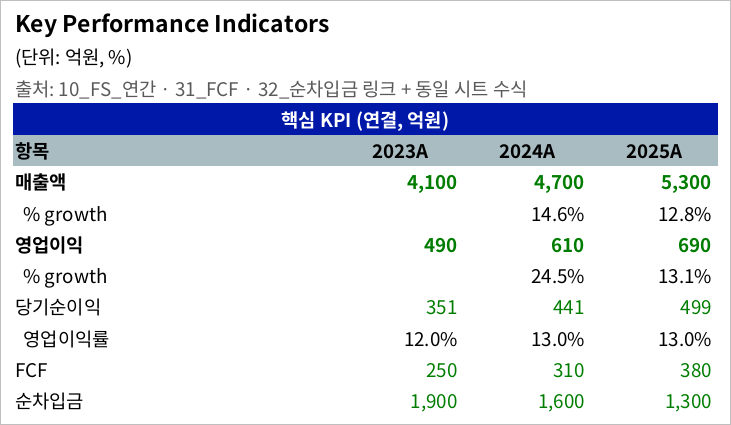
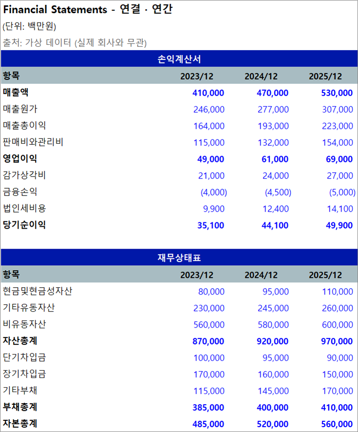
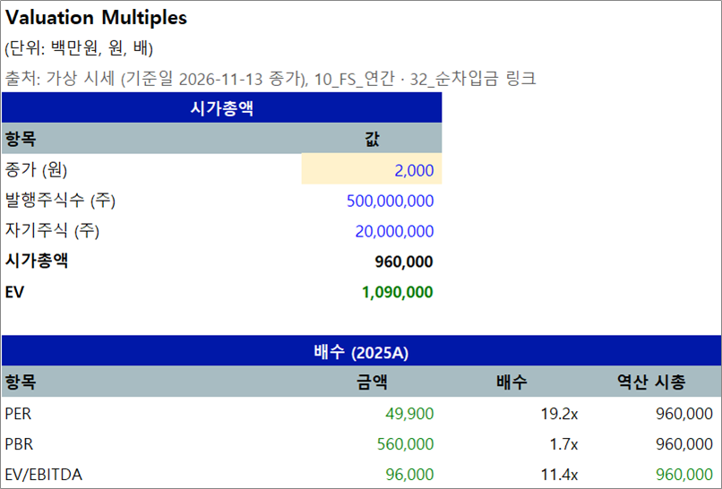
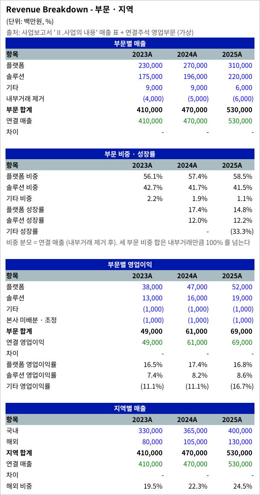
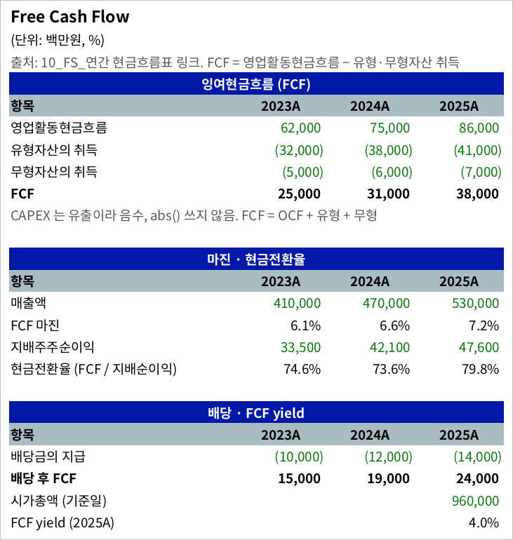
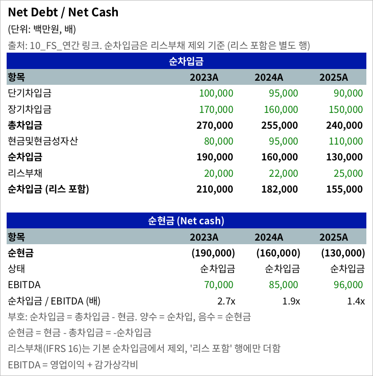
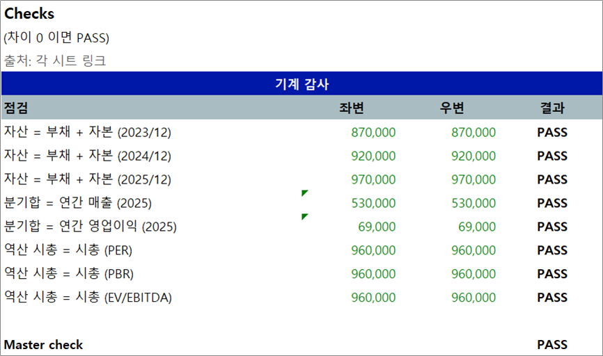

# IB 양식 규격. 데이터셋이 깔끔하게 나오는 이유

데이터셋은 사람이 손으로 다듬지 않습니다. 서식 규칙을 코드로 고정해 두고 시트 내용만 선언하면 어느 회사든 같은 모양으로 나옵니다. 이 문서는 그 규칙과, 실제 데이터셋 1건을 열어 실측한 값을 정리한 것입니다.

화면은 모두 가상 회사 '가온테크' 샘플입니다. [scripts/build_ib_sample.py](../scripts/build_ib_sample.py) 로 다시 만들 수 있습니다.

## 1. 색 규칙

셀을 누르지 않고도 그 숫자가 어디서 왔는지 알 수 있게 하는 규칙입니다.

| 글자색 | 색상값 | 의미 | 예 |
|---|---|---|---|
| 파랑 | `0000FF` | 직접 입력한 원자료 | 공시에서 받은 매출액 |
| 검정 | `000000` | 같은 시트 안의 수식 | 성장률, 합계 |
| 초록 | `007D00` | 다른 시트를 참조하는 수식 | KPI 시트가 재무제표 시트를 링크 |
| 노랑 바탕 | `FFF2CC` | 사람이 확인해야 하는 판단값 | 기준 종가, WACC |



KPI 시트의 금액은 전부 초록입니다. 재무제표, FCF, 순차입금 시트의 값을 100으로 나눠 억원으로 바꾼 링크이기 때문입니다. 성장률과 이익률은 같은 시트 안의 계산이라 검정입니다. 이 시트에는 파랑이 하나도 없어야 정상이고, 파랑이 보이면 누군가 값을 덮어쓴 것입니다.

## 2. 시트 골격

모든 시트가 같은 자리에 같은 정보를 둡니다.

| 위치 | 내용 | 서식 |
|---|---|---|
| A열 | 여백 | 너비 0.9 |
| B열 | 라벨 | 너비 26~30 |
| C열부터 | 데이터 | 너비 11 |
| 1행 | 시트 제목 | 11pt 굵게 |
| 2행 | 단위 | 9pt. 예: (단위: 백만원, IFRS) |
| 3행 | 출처 | 9pt 회색 `595959` |
| 4행 | 구획 띠 | 남색 `0018A8` 바탕, 흰 글자, 굵게 |
| 5행 | 머리글 (기간) | 회청색 `A8BCC2` 바탕, 굵게, 가운데 |
| 6행부터 | 데이터 | 9pt, 숫자는 오른쪽 정렬 |

그 밖의 규칙입니다.

- 글꼴은 전부 맑은 고딕 9pt, 격자선은 끔.
- 틀 고정은 데이터 첫 칸(C6 또는 C7). 스크롤해도 라벨과 기간이 남습니다.
- 셀 병합을 쓰지 않습니다. 구획 띠는 "선택 영역의 가운데" 정렬로 만듭니다. 병합은 정렬, 필터, 복사에서 문제를 일으킵니다.
- 합계와 주요 행(매출액, 영업이익, 자산총계)은 굵게.
- 보조 행(% growth, % margin)은 두 칸 들여쓰기.
- 2행에 단위를 반드시 적습니다. 단위 라벨 오류가 100배 오차의 원인이었기 때문입니다.



## 3. 숫자 형식

| 종류 | 형식 코드 | 표시 예 |
|---|---|---|
| 금액 | `#,##0_);(#,##0);-` | 1,234 / (1,234) / - |
| 소수 1자리 | `#,##0.0_);(#,##0.0);-` | 12.3 / (12.3) / - |
| 퍼센트 | `0.0%_);(0.0%);-` | 12.3% / (12.3%) / - |
| 배수 | `0.0x` | 19.2x |

- 음수는 괄호. 빼기 기호보다 눈에 잘 띄고 인쇄해도 사라지지 않습니다.
- 0은 하이픈. 값이 0인 것과 비어 있는 것(미수집)을 구분합니다.
- 퍼센트는 분수로 저장합니다(12.3%는 0.123). 문자열이나 12.3으로 저장하면 다른 수식에서 못 씁니다.
- 양수 뒤에 괄호 한 칸만큼 여백을 둬서 양수와 음수의 자릿수가 세로로 맞습니다.

## 4. 시트 번호 체계

시트 이름 앞의 번호로 성격을 구분합니다. 회사마다 시트 수가 달라도 같은 번호는 같은 내용입니다.

| 번호 | 내용 | 원천 |
|---|---|---|
| 00 | README: 데이터 사전, 색 규칙, 제외한 것, 기준일과 한계 | - |
| 01 | KPI: 핵심지표 (링크와 수식만) | 10번대 |
| 10~13 | 재무제표: 연결·별도 x 연간·분기 | 공시 API (파랑) |
| 14 | 투자지표, 증권사 추정치 | 시세 사이트 |
| 15 | 재무비율 (전부 10번 참조 수식) | 10번대 |
| 16~2x | 배당, 주식수, 밸류에이션 배수, Historical PER/PBR | 공시, 시세 |
| 30~4x | 매출 구성(30), FCF(31), 순차입금(32), 오버행, 주요 공시 | 공시 원문, 공시 API, 10번대 |
| 50~5x | 지분구조, 대량보유·임원 보고 | 공시 API |
| 60~6x | 업종 KPI | 통계, IR |
| 70~7x | 수급 (기관·외국인, 250거래일) | 시세 사이트 |
| 99 | Check: 파일 안의 점검과 종합 결과 | 각 시트 링크 |

샘플의 10개 시트는 이 체계를 그대로 따릅니다.

| 샘플 시트 | 번호 | 내용 |
|---|---|---|
| 00_README | 00 | 데이터 사전, 색 규칙, 제외한 것, 정의 |
| 01_KPI | 01 | 매출, 이익, FCF, 순차입금 (억원 링크) |
| 10_FS_연간, 11_IS_분기 | 10~13 | 연간 손익·재무상태·현금흐름, 분기 손익 |
| 15_재무비율 | 15 | 수익성, 안정성 비율 |
| 20_밸류에이션 | 16~2x | 시가총액, EV 산출, 배수와 역산 |
| 30_매출구성 | 30 | 부문별 매출·영업이익, 지역별 매출 |
| 31_FCF | 31 | FCF, 마진, 현금전환율, FCF yield |
| 32_순차입금 | 32 | 순차입금(리스 제외·포함), 순현금 |
| 99_Check | 99 | 항등식, 분기합, 부문합, FCF, EV, 배수 역산 |

**실측.** 국내 상장사 데이터셋 1건을 열어 센 결과입니다: 22개 시트, 수식 673개, 전 시트 격자선 꺼짐, 전 시트 틀 고정. 재무제표 4개 시트는 수식 0개(전부 파랑 원자료), KPI 시트는 값 68칸 중 43칸이 수식입니다. 원자료 층과 계산 층이 섞이지 않았다는 뜻입니다.

## 5. README 시트

데이터셋의 첫 시트에 세 가지를 적습니다.

- **데이터 사전**: 시트별 내용, 단위, 기간.
- **제외한 것**: 줄글(연혁, 사업모델, 논지)과 밸류에이션 모델링은 싣지 않습니다. 공시되지 않아 못 넣은 지표도 여기 적습니다.
- **기준일과 한계**: 시세 기준일, 추정치가 없는 종목의 빈칸이 누락이 아니라는 설명.

"없는 것을 있는 줄 알지 않게" 하는 장치입니다. 데이터셋에는 숫자만 두고 해석은 넣지 않습니다. 해석이 섞이면 숫자를 믿을 수 없게 됩니다.

## 6. 밸류에이션: EV 산출과 배수 역산

20_밸류에이션은 시가총액에서 EV를 만들고, 그 EV와 시총으로 배수를 낸 뒤 다시 시총으로 되돌려 봅니다.

- **시가총액** = (발행주식수 − 자기주식) × 기준일 종가. 샘플: (500,000,000주 − 20,000,000주) × 2,000원 = 960,000 백만원.
- **EV** = 시가총액 + 순차입금 + 비지배지분 − 관계기업투자. 샘플: 960,000 + 130,000 + 35,000 − 70,000 = 1,055,000. 순차입금은 32_순차입금, 비지배지분과 관계기업투자는 10_FS_연간을 링크하므로 초록입니다. 시총은 기준일, 나머지는 2025A 말 장부 잔액입니다.
- **배수** (2025A): PER 20.2x (지배주주순이익 47,600), PBR 1.8x (지배주주지분 525,000), EV/EBITDA 11.0x (EBITDA 96,000), EV/Sales 2.0x (매출 530,000).
- **역산**: 각 배수 옆에 "금액 x 배수"를 다시 계산한 역산 시총을 둡니다. EV 배수 두 줄은 금액 x 배수에서 (EV − 시총)을 빼서 시총으로 되돌립니다. 네 줄이 모두 960,000으로 돌아와야 하고, 한 줄이라도 다르면 금액, 배수, 주식수, EV 브리지 항목 중 하나가 틀린 것입니다.



## 7. 매출 구성, FCF, 순차입금

재무제표 다음 층입니다. 세 시트의 금액은 10_FS_연간 링크(초록)와 같은 시트 수식(검정)이고, 원자료(파랑)는 30_매출구성의 부문·지역 금액뿐입니다. 부문합과 지역합은 시트 안의 '차이' 행으로, FCF와 EV는 99_Check에서 공시 계정으로 다시 계산해 대조합니다. 원천과 자동화 수준은 [데이터 원천 문서](08_data_sources.md) 3절에 있습니다.

### 30_매출구성



- 부문 매출(파랑 원자료)을 더해 연결 매출(초록 링크)과 뺀 '차이' 행을 둡니다. 2025A: 플랫폼 310,000 + 솔루션 220,000 + 기타 6,000 + 내부거래 제거 (6,000) = 530,000, 차이 0.
- 부문 영업이익 합 69,000이 연결 영업이익과 같은지도 같은 방식으로 봅니다.
- 지역 매출: 국내 400,000, 해외 130,000. 해외 비중 24.5%. 비중의 분모는 내부거래 제거 후 연결 매출이라 세 부문 비중의 합은 100%를 조금 넘습니다(플랫폼 58.5%).
- 한계: 실제 파이프라인에서 부문·지역 매출은 사업보고서 XML 표를 회사별로 해석해야 해서 완전 자동이 아닙니다. 7단계 체크리스트에 수작업 항목으로 나옵니다.

### 31_FCF



- FCF = 영업활동현금흐름 + 유형자산의 취득 + 무형자산의 취득. CAPEX는 유출이라 음수로 저장하고 `abs()` 를 쓰지 않습니다. 2025A: 86,000 + (41,000) + (7,000) = 38,000.
- FCF 마진 7.2%, 현금전환율(FCF ÷ 지배주주순이익) 79.8%, 배당 (14,000) 후 FCF 24,000, FCF yield(시총 대비) 4.0%.
- 한계: 실제 파이프라인의 CAPEX 수집 스크립트(`fetch_capex.py`)는 이 저장소에 없습니다.

### 32_순차입금



- 순차입금 = 총차입금 − 현금. 2025A: 240,000 − 110,000 = 130,000. 부호는 양수가 순차입, 음수가 순현금이고, 순현금 행은 그 반대 부호라 (130,000)으로 보입니다.
- 리스부채 25,000은 기본 순차입금에서 빼고 '순차입금 (리스 포함)' 행에만 더합니다(155,000). EV 산출에는 리스 제외 값이 들어갑니다.
- 순차입금/EBITDA 1.4x.

## 8. 파일 안의 검증

99_Check는 항등식, 분기합, 부문합, FCF, EV 브리지, 배수 역산 17개를 한곳에 모으고 마지막에 종합 결과(Master check)를 냅니다.



## 9. 저장 후 절차

1. 파이썬으로 저장한 직후에는 수식 값이 비어 있습니다. Excel로 열어 재계산하고 다시 저장합니다.
2. 오류 셀(`#REF!`, `#DIV/0!` 등)을 세어 0인지 확인합니다.
3. 감사 도구를 돌립니다.
4. 통과하면 `YYMMDD_회사명_Data` 폴더에 같은 이름으로 배포합니다.

샘플의 검증 결과는 [examples/verify_report.md](../examples/verify_report.md) 에 있습니다: 시트 10개, 오류 셀 0개, 점검 17개 전부 통과. 샘플은 Excel 대신 LibreOffice headless로도 재계산할 수 있습니다([scripts/verify_sample_lo.py](../scripts/verify_sample_lo.py)). LibreOffice는 값 계산과 캡처에만 쓰고, 배포 파일은 openpyxl이 만든 원본 그대로입니다.

## 10. 코드에서는 어떻게 쓰나

서식을 한 모듈에 상수로 두고, 시트는 행을 선언하기만 합니다. 값의 종류(input, formula, link)를 주면 색이 정해집니다.

```python
kp = Sheet(wb, "01_KPI", "Key Performance Indicators", "(단위: 억원, %)", "출처: 10_FS_연간 링크")
kp.band("핵심 KPI (연결, 억원)", 4)
kp.header(["항목", "2023A", "2024A", "2025A"])
kp.row("매출액", ["='10_FS_연간'!C6/100", ...], kind="link", bold=True)   # 초록
kp.row("  % growth", [None, "=IFERROR(D6/C6-1,\"\")", ...], kind="formula", fmt=PCT)  # 검정
```

색을 사람이 고르지 않고 값의 종류가 정하기 때문에, 링크인데 파랑으로 칠해지는 실수가 생기지 않습니다.
