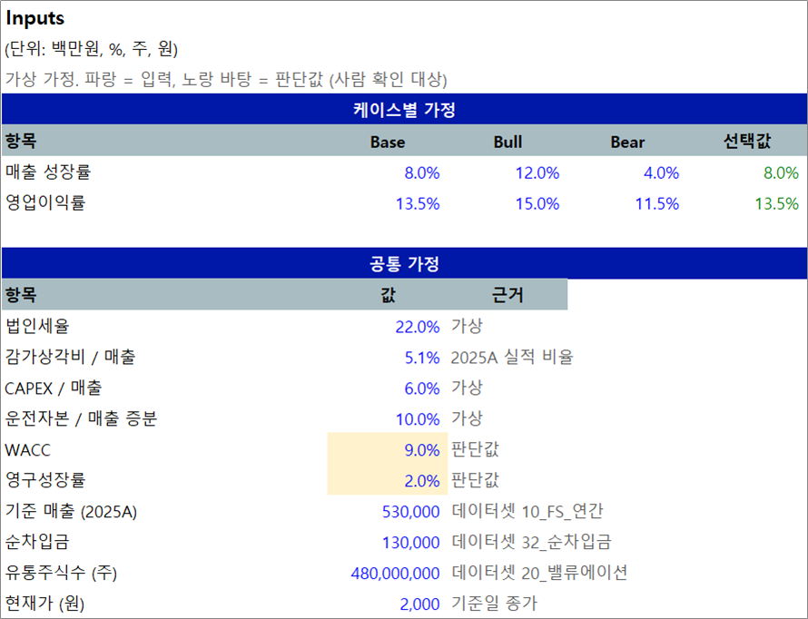
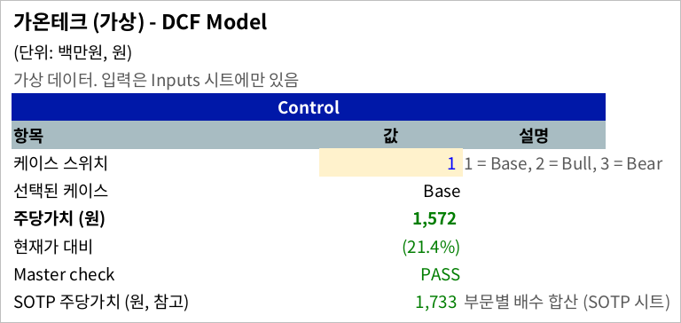
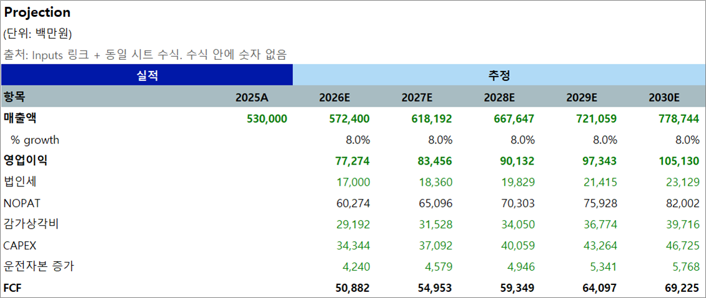
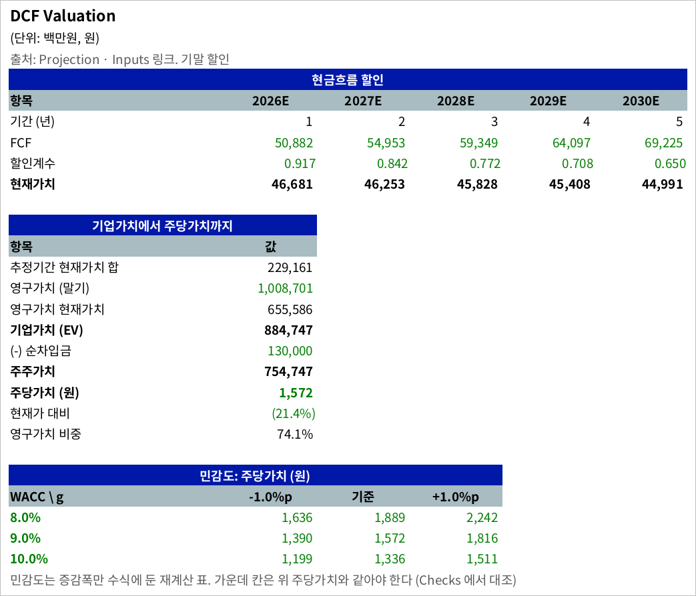
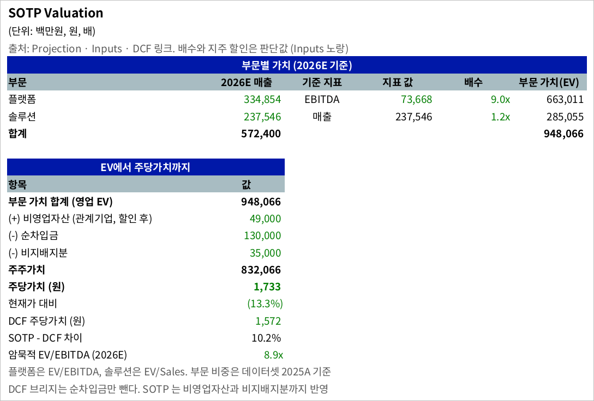

# 모델 빌드. 입력 한 파일에서 검증된 모델까지

재무모델은 엑셀을 직접 고치지 않고 **입력 파일을 고쳐 다시 빌드**합니다. 손으로 고친 모델은 무엇이 바뀌었는지 추적할 수 없고, 다음 갱신 때 같은 수정을 다시 해야 하기 때문입니다.

화면은 가상 회사 샘플입니다. [scripts/build_ib_sample.py](../scripts/build_ib_sample.py) 가 6개 시트(Cover, Inputs, Projection, DCF, SOTP, Checks)로 만들고, [scripts/verify_sample.py](../scripts/verify_sample.py) (Windows + Excel) 또는 [scripts/verify_sample_lo.py](../scripts/verify_sample_lo.py) (LibreOffice, Linux·macOS·Windows) 가 3케이스 전부를 검증합니다. DCF와 SOTP 두 방법으로 주당가치를 냅니다. 실제 엔진은 입력을 yaml 파일로 받고 유형과 점검 항목이 훨씬 많지만, 구조와 원칙은 같습니다.

## 표준 흐름

| 단계 | 내용 | 멈추는 조건 |
|---|---|---|
| 0. 확정 3가지 | 대상, 목적, 기준일 | 질문은 한 번에 하나. 판단이 갈리지 않는 것은 기본값으로 진행하고 "사용한 기본값" 표를 붙임 |
| 1. 유형 선언 | 13개 유형 중 무엇으로 볼지 한 줄로 알림 | 빌더가 없는 유형이면 여기서 멈추고 없다고 말함 |
| 2. 사실 수집 | 재무, 시세, 할인율 재료를 묻지 않고 받음 | 사용자만 줄 수 있는 것(사업계획, 계약 조건)은 요청 |
| 3. 입력 작성 | 입력 파일 하나. 숫자마다 출처와 기준일 | 사실은 단일값, 판단이 갈리는 가정은 Base·Bull·Bear |
| 4. 빌드 | 입력 파일에서 워크북 생성 | "쓰이지 않은 입력" 경고가 0이 될 때까지 |
| 5. 3관문 | Check, Lint, 독립 재계산 | 하나라도 실패하면 보고하지 않고 고침 |
| 6. 보고 | 결론, 케이스 표, 사실과 판단 구분, 점검 결과, 민감도, 미확인 사실 | - |

## 워크북 구조

| 시트 | 역할 | 규칙 |
|---|---|---|
| Cover | 케이스 스위치, 핵심 결과, 종합 점검 | 스위치 한 칸으로 전체가 바뀜 |
| Inputs | 모든 입력 | 파란 입력은 이 시트에만 |
| Projection | 추정 손익과 현금흐름 | Inputs 링크와 같은 시트 수식만 |
| DCF | 할인, 기업가치, 주당가치, 민감도 | 순차입금 정의를 명시 |
| SOTP | 부문별 배수로 가치를 더해 주당가치 | 배수와 할인율은 Inputs의 판단값만 참조 |
| Checks | 모델 점검 | FAIL이 하나라도 있으면 납품하지 않음 |

### Inputs: 입력은 한 시트에만

- 케이스별 가정은 Base, Bull, Bear를 나란히 두고 "선택값" 열이 스위치에 따라 하나를 고릅니다. 선택값은 Cover를 참조하므로 초록입니다.
- 판단값(WACC, 영구성장률, SOTP의 부문 배수와 지주 할인)은 노랑 바탕입니다. 에이전트가 정하지 않고 사람이 확인하는 자리입니다.
- 입력마다 근거 열이 있습니다. 실제 모델에서는 출처와 기준일을 적습니다.

### Cover: 스위치 한 칸

C6이 스위치, C8이 DCF 주당가치, C10이 Master check, C11이 SOTP 주당가치(참고)입니다. 케이스를 값 붙여넣기로 따로 만들지 않습니다. 스위치를 1에서 2로 바꾸면 전 시트가 다시 계산됩니다. 정적인 시나리오 표는 가정을 고쳤을 때 갱신되지 않아 틀린 숫자가 남습니다.

### Projection: 수식 안에 숫자 없음

머리글 위의 띠로 실적(남색)과 추정(하늘색) 구간을 구분합니다. 추정 구간의 모든 값은 Inputs를 참조합니다. `=C6*1.08` 처럼 수식 안에 숫자를 넣으면 가정이 숨어 버려서 린터가 실패로 처리합니다. Projection 수식에는 가정 숫자가 하나도 없습니다(성장률 계산의 `1+`, `-1` 같은 구조 상수만 있음). DCF와 SOTP에 남은 숫자는 두 종류뿐입니다: 백만원을 원으로 바꾸는 단위 환산 `1000000`, 민감도 표의 간격 ±0.01.

### DCF: 기업가치에서 주당가치까지

- 기업가치에서 순차입금을 빼 주주가치로 가는 과정을 한 줄씩 보여줍니다.
- 영구가치 비중을 따로 표시합니다. 이 비중이 너무 높으면 추정기간이 아니라 말기 가정이 가치를 정하는 모델입니다.
- 민감도 표는 붙여넣은 값이 아니라 살아 있는 수식입니다. 가운데 칸이 위의 주당가치와 같은지 Checks가 대조합니다.

### SOTP: 부문별 배수 합산

부문마다 맞는 배수로 가치를 매겨 더합니다. 2026E Base 기준입니다(단위 백만원).

| 항목 | 계산 | 값 |
|---|---|---|
| 플랫폼 | 매출 334,854 → EBITDA 73,668 (마진 22%) × EV/EBITDA 9.0x | 663,011 |
| 솔루션 | 매출 237,546 × EV/Sales 1.2x | 285,055 |
| 영업 EV | 부문 가치 합계 | 948,066 |
| (+) 관계기업 | 70,000 × (1 − 지주 할인 30%) | 49,000 |
| (−) 순차입금 | 데이터셋 32_순차입금 | 130,000 |
| (−) 비지배지분 | 데이터셋 10_FS_연간 | 35,000 |
| 주주가치 | | 832,066 |
| 주당가치 | 주주가치 ÷ 유통주식수 480,000,000주 | 1,733원 |

- 암묵적 EV/EBITDA(영업 EV ÷ 2026E 연결 EBITDA)는 8.9x입니다. 부문 배수를 정한 결과가 연결 기준으로 몇 배인지 보여 줘서, 배수가 과하거나 모자란지 한눈에 봅니다.
- DCF 브리지는 순차입금만 빼지만, SOTP는 비영업자산(관계기업)과 비지배지분까지 반영합니다.
- 판단값은 세 개입니다: 플랫폼 EV/EBITDA 9.0x, 솔루션 EV/Sales 1.2x, 지주 할인 30%. 모두 Inputs에 노랑 바탕으로 있고 SOTP 시트에는 링크만 있습니다.

| 케이스 | DCF 주당가치 | SOTP 주당가치 |
|---|---|---|
| Base | 1,572 | 1,733 |
| Bull | 2,105 | 1,807 |
| Bear | 1,076 | 1,660 |

SOTP는 케이스에 따라 매출만 바뀌고 배수와 마진은 고정이라 DCF보다 범위가 좁습니다. 그래서 Bull에서는 DCF(2,105원)가 SOTP(1,807원)보다 높습니다.

한계: 샘플의 부문 비중(플랫폼 58.5%)은 데이터셋 30_매출구성의 2025A 값을 그대로 쓰고 2026E에도 같다고 둡니다. SOTP는 데이터셋이 아니라 이 모델 워크플로우에서 만드는 것이고, 샘플의 배수와 할인율은 가상 판단값입니다.

## 3관문

| 관문 | 무엇을 보나 | 샘플 결과 |
|---|---|---|
| Check | 재계산 후 오류 셀 0, 내부 점검 FAIL 0 | 3케이스 모두 오류 셀 0, Master check PASS |
| Lint | 구조 규칙 위반 (아래 금지 목록) | 샘플에는 린터 미포함 |
| 독립 재계산 | 엑셀 수식과 무관하게 파이썬으로 다시 계산해 대조 | 3케이스 DCF·SOTP 모두 차이 0.0000원 |

**모든 케이스를 봅니다.** Base만 확인하고 통과시키면 다른 케이스에서만 깨지는 수식을 놓칩니다. 검증 스크립트는 스위치를 1, 2, 3으로 바꿔 가며 각각 재계산하고 대조합니다.

| 케이스 | DCF 엑셀 | DCF 독립 재계산 | SOTP 엑셀 | SOTP 독립 재계산 | Master check |
|---|---|---|---|---|---|
| Base | 1,572 | 1,572 | 1,733 | 1,733 | PASS |
| Bull | 2,105 | 2,105 | 1,807 | 1,807 | PASS |
| Bear | 1,076 | 1,076 | 1,660 | 1,660 | PASS |

출처: [examples/verify_report.md](../examples/verify_report.md) (가상 데이터)

검증기는 두 가지입니다. [scripts/verify_sample.py](../scripts/verify_sample.py) 는 Windows의 Excel로 재계산하고, [scripts/verify_sample_lo.py](../scripts/verify_sample_lo.py) 는 LibreOffice headless로 같은 검증을 해서 Linux, macOS, Windows에서 돕니다. 위 표는 LibreOffice 검증기로 낸 결과이고, 엑셀 수식 값과 [scripts/independent.py](../scripts/independent.py) 의 독립 재계산 차이가 3케이스 DCF·SOTP 모두 0.0000원입니다. LibreOffice는 값 계산과 화면 캡처에만 쓰고, 배포하는 xlsx는 openpyxl이 만든 원본 그대로입니다.

실제 엔진의 검증은 라벨 문자열이 아니라 고유 키로 셀을 찾고 찾은 개수를 확인합니다. 라벨이 바뀌면 엉뚱한 셀을 읽고도 통과할 수 있기 때문입니다. 샘플 검증기는 이를 단순화해 B열 라벨이 정확히 같은 첫 행을 읽고, 라벨이 없으면 오류로 멈춥니다(찾은 개수는 확인하지 않음).

## 하지 않는 것

품질 기준 문서의 결함 목록에서 자주 걸리는 것만 골랐습니다.

| 구조 | 계산 | 절차 |
|---|---|---|
| 값 붙여넣기로 연결 끊기 | 라벨과 다른 계산 (이름은 영업이익률인데 매출총이익률) | 목표가를 먼저 정하고 가정을 역산 |
| 수식 안 숫자 | 영구가치를 기중 할인 | 판단값을 말없이 변경 |
| Inputs 밖의 파란 입력 | 순차입금에서 현금 이중 차감 | 엑셀을 직접 수정 |
| `TODAY()` 로 만든 시간축 | 감쇠 없는 영구 성장 | 사용자 원본 파일 덮어쓰기 |
| 정적 시나리오 표 | 손실을 `MAX(…,0)` 으로 가리기 | 지원하지 않는 유형을 억지로 근사 |

## 사람이 정하는 것

- **판단값은 사람이.** 위험프리미엄, 규모 프리미엄, 차입 비용, 영구성장률은 재료를 모아 제시하고 확정은 사람이 합니다.
- **확정한 결정은 되돌리지 않습니다.** 단일 케이스로 가기로 했으면 다음 세션에서 3케이스로 되돌리지 않도록 결정 로그를 남깁니다.
- **이미 만든 부문 모델은 그대로 옮깁니다.** 사용자가 만든 법인별 시트를 새로 짜지 않고 행 순서, 라벨, 단위를 보존해 옮기고 원본과 대조하는 행을 둡니다.
- **"간단하게" 요청은 영향부터 보여줍니다.** 정확도를 깎기 전에 무엇을 잃는지 숫자로 먼저 알립니다.
- **기밀 입력은 옮기지 않습니다.** 비공개 자료의 수치는 문서, 코드, 메모에 적지 않고, 쓴 뒤 스캔 도구로 대조합니다.

## 납품물

모델 하나에 다섯 가지가 같이 나갑니다: 워크북, 입력 파일, Check 리포트, Lint 리포트, 가정과 변경 로그. 워크북만 받으면 왜 이 숫자인지 다시 물어야 하기 때문입니다.
