# 공시·IR 원자료를 검증 가능한 데이터셋과 모델로 - Claude Code 운영 포트폴리오

> AI 에이전트를 지휘해 비정형 공시·IR 원자료를 **검증 가능한 분석용 데이터셋과 재무모델**로 만듭니다.
> 빠르게 만드는 것보다, 틀린 숫자를 걸러내고 같은 결과를 다시 만들 수 있게 하는 데 집중했습니다.

작성자: 박도현 / [dhpark19955@gmail.com](mailto:dhpark19955@gmail.com) / 투자·FP&A 실무

## 한눈에 보기

| 항목 | 규모 | 비고 |
|---|---|---|
| 기업 데이터셋 | 18개사 | 국내 상장 12, 해외 상장 4, 비상장 2 (2026-11 기준 보관본) |
| 표준 데이터셋 | 회사당 22개 시트 안팎 | 실측 1건: 22개 시트, 수식 673개, 원자료 층과 계산 층 분리 |
| 자체 제작 스킬 | 4종 | 데이터셋 빌드, 원자료 수집, 모델 빌더, 주간 작업기록 |
| 서브에이전트 | 3종 | worker(구현), helper(단순 작업), checker(읽기 전용 검수) |
| 누적 작업 메모 | 149건 | 함정, 결정 사항, 출처 경로를 세션 간에 유지 |

## 결과물은 이렇게 나옵니다

가상 회사 샘플입니다. 사람이 다듬지 않고 코드가 만든 그대로입니다.

| 데이터셋: KPI 시트 | 모델: DCF 시트 |
|---|---|
| 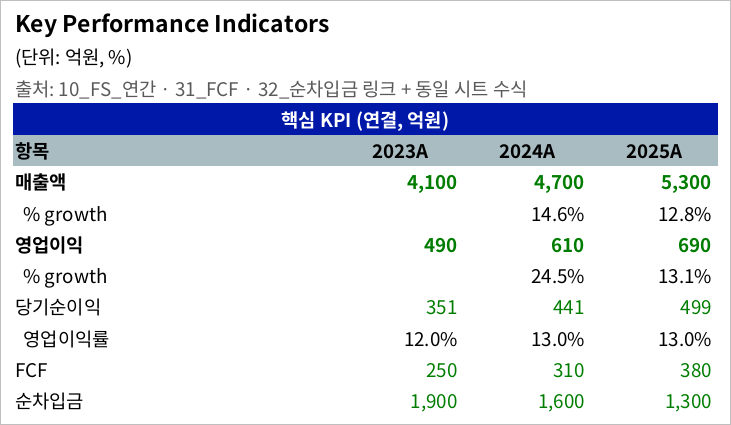 | 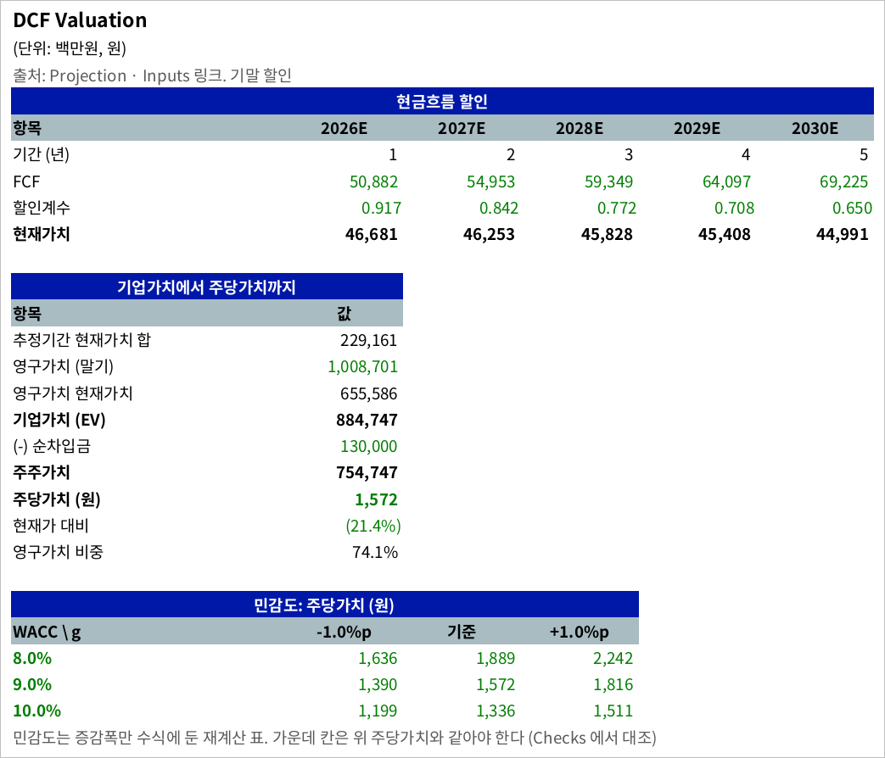 |

- 파랑은 입력한 원자료, 검정은 같은 시트 수식, 초록은 다른 시트 링크입니다. 셀을 누르지 않아도 숫자의 출처가 보입니다.
- 모델은 스위치 한 칸으로 Base, Bull, Bear가 바뀌고, 세 케이스 모두 DCF와 SOTP 주당가치를 엑셀과 무관한 독립 재계산과 대조했습니다.

| 파일 | 시트 | 검증 결과 |
|---|---|---|
| [`sample_dataset_ib.xlsx`](https://github.com/dhpark19955-code/claude-code-data-portfolio/blob/main/demo/output/sample_dataset_ib.xlsx) | 10개: 00_README, 01_KPI, 10_FS_연간, 11_IS_분기, 15_재무비율, 20_밸류에이션, 30_매출구성, 31_FCF, 32_순차입금, 99_Check | 오류 셀 0개, 점검 17개 전부 PASS. 단위 백만원(KPI만 억원) |
| [`sample_model_dcf.xlsx`](https://github.com/dhpark19955-code/claude-code-data-portfolio/blob/main/demo/output/sample_model_dcf.xlsx) | 6개: Cover, Inputs, Projection, DCF, SOTP, Checks | Base, Bull, Bear 3케이스 전부 PASS |

검증 결과 원문: [`demo/output/verify_report.md`](https://github.com/dhpark19955-code/claude-code-data-portfolio/blob/main/demo/output/verify_report.md)

## 무엇을 구할 수 있나

데이터셋은 재무제표에서 끝나지 않고 매출 세부, FCF, 순차입금, EV까지 구합니다. SOTP는 데이터셋 밖의 별도 모델에서 만듭니다. 샘플 수치는 가상 회사 '가온테크'의 2025A(SOTP는 2026E Base) 값이고 단위는 백만원입니다.

| 항목 | 담기는 시트 | 샘플 수치 | 자동화 범위 |
|---|---|---|---|
| 부문·제품 매출 | 30_매출구성 | 플랫폼 310,000 / 솔루션 220,000 / 기타 6,000 / 내부거래 제거 (6,000) = 530,000. 연결 매출과 차이 0. 부문 영업이익 합 69,000 = 연결 영업이익. 플랫폼 비중 58.5% | 반자동. 원문 수집은 자동, 사업보고서 XML 표 해석은 회사별 작업이라 파이프라인 7단계 체크리스트에 수작업 항목으로 나옴 |
| 지역 매출 | 30_매출구성 | 국내 400,000 / 해외 130,000. 해외 비중 24.5% | 반자동. 위와 같음 |
| FCF | 31_FCF | 영업활동현금흐름 86,000 + 유형자산 취득 (41,000) + 무형자산 취득 (7,000) = 38,000. FCF 마진 7.2%, 현금전환율 79.8%, 배당 후 FCF 24,000, FCF yield 4.0% | 자동. 다만 CAPEX 수집 스크립트(`fetch_capex.py`)는 이 저장소에 없음 |
| 순차입금·순현금 | 32_순차입금 | 총차입금 240,000 − 현금 110,000 = 순차입금 130,000. 리스 포함 155,000. 순현금 (130,000). 순차입금/EBITDA 1.4x | 자동. 차입금 별칭 누락은 경고로 잡음 |
| EV 산출 | 20_밸류에이션 | 시가총액 960,000 + 순차입금 130,000 + 비지배지분 35,000 − 관계기업투자 70,000 = EV 1,055,000 | 자동 (시트 수식) |
| 배수와 역산 | 20_밸류에이션, 99_Check | PER 20.2x, PBR 1.8x, EV/EBITDA 11.0x, EV/Sales 2.0x. 네 배수 모두 역산하면 시가총액 960,000 | 자동 (시트 수식과 감사 도구) |
| SOTP | 모델의 SOTP 시트 | 플랫폼 663,011 + 솔루션 285,055 = 영업 EV 948,066 → 주당가치 1,733원 (DCF 1,572원) | 데이터셋 밖의 별도 모델 워크플로우. 부문 배수와 할인율은 사람이 정하는 판단값 |

- 순차입금은 양수면 순차입, 음수면 순현금입니다. 리스부채는 기본 순차입금에서 빼고 '리스 포함' 행에만 더합니다.
- FCF의 CAPEX는 유출이라 음수로 저장하고, FCF = 영업활동현금흐름 + 유형 + 무형으로 더합니다.
- 각 항목의 원천, 계산 방법, 정의는 [`docs/08_data_sources.md`](https://github.com/dhpark19955-code/claude-code-data-portfolio/blob/main/docs/08_data_sources.md) 에 있습니다.

| 데이터셋: 매출 구성 | 데이터셋: FCF |
|---|---|
| 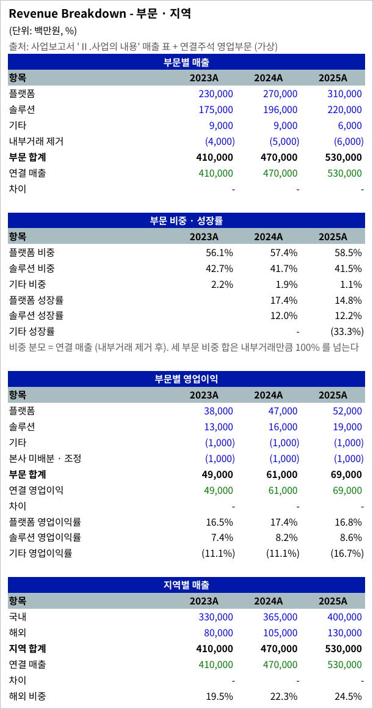 | 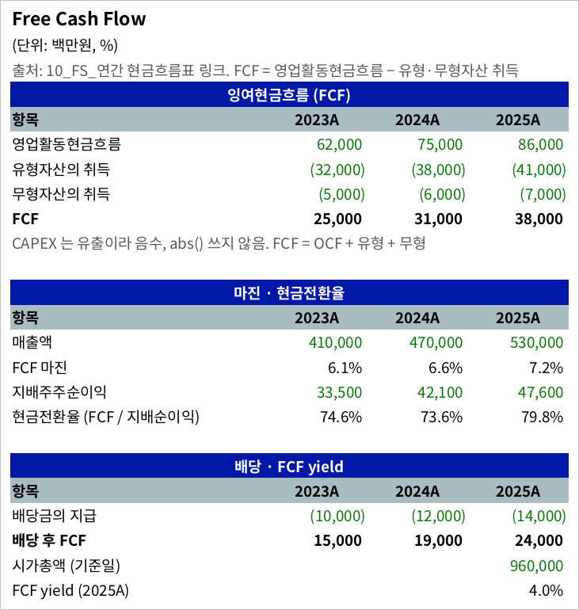 |

| 데이터셋: 순차입금 | 데이터셋: EV 산출과 배수 역산 |
|---|---|
| 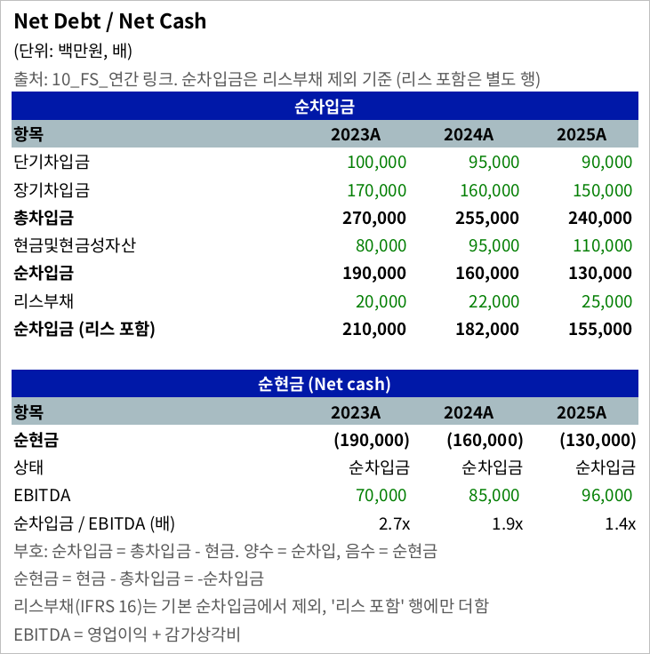 | 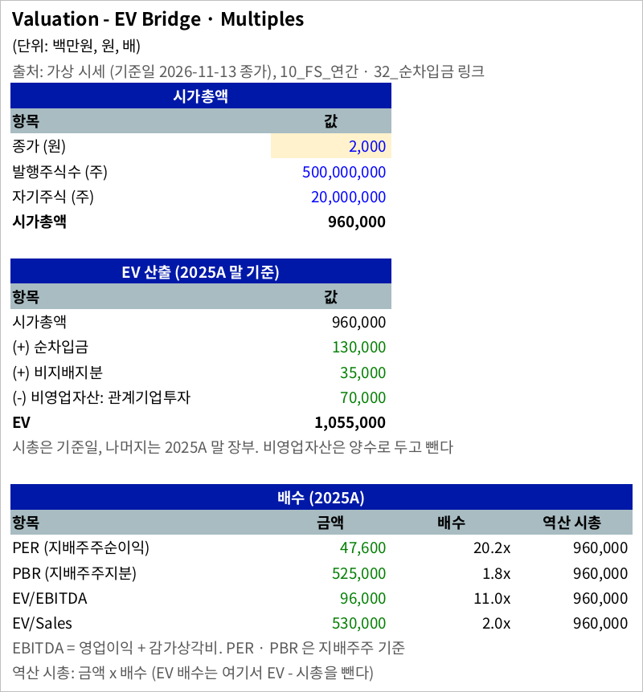 |

| 모델: SOTP |
|---|
| 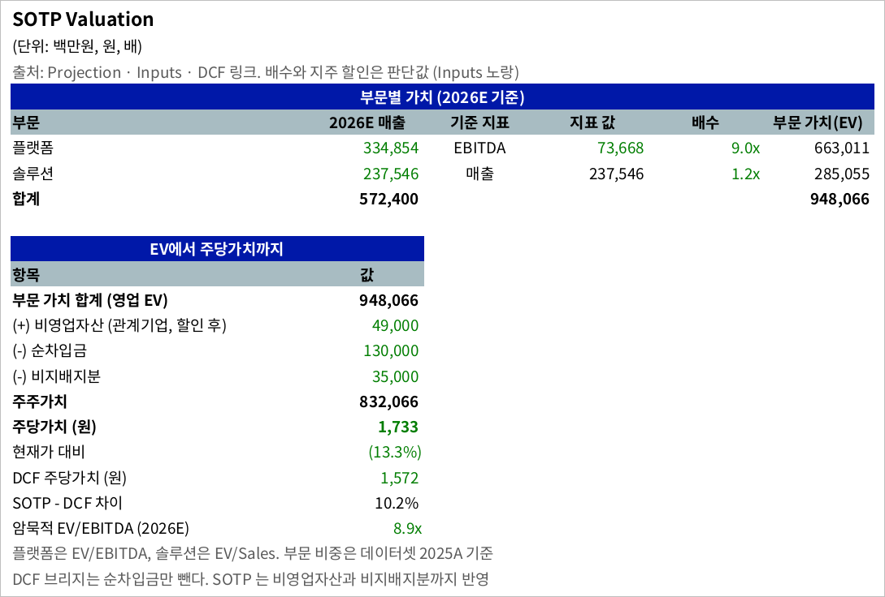 |

## 사용하는 API

원천은 모두 공개 자료입니다. 키는 환경변수나 키 파일에서 읽고 코드에 적지 않습니다. 엔드포인트별 파라미터, 받는 것, 코드 위치, 막힌 경로와 대체는 [`docs/08_data_sources.md`](https://github.com/dhpark19955-code/claude-code-data-portfolio/blob/main/docs/08_data_sources.md) 에 있습니다.

| 원천 | 주요 엔드포인트 | 받는 것 | 키 |
|---|---|---|---|
| 공시 API (OpenDART) | `fnlttSinglAcntAll.json`, `stockTotqySttus.json`, `majorstock.json`, `elestock.json`, `alotMatter`, `hyslrSttus`, `tesstkAcqsDspsSttus`, `corpCode.xml`, `document.xml` | 재무제표 전 계정(현금흐름표의 CAPEX 줄 포함), 주식 총수, 지분 보고, 배당, 자기주식, 공시 원문 | DART |
| 시세 (네이버 증권 JSON) | `polling.finance.naver.com/api/realtime/domestic/stock/{code}`, `m.stock.naver.com/api/stock/{code}/integration`, `api.stock.naver.com/chart/domestic/item/{code}/day`, `fchart.stock.naver.com/siseJson.naver`, `m.stock.naver.com/api/stock/{code}/trend`, `m.stock.naver.com/api/stock/{code}/finance/annual` · `/finance/quarter` | 종가, 시총·투자지표, 일별 시세, 투자자별 수급, 재무요약·컨센서스 | 없음 |
| 통계 (KOSIS) | `statisticsParameterData.do`, `getMeta` | 업종 통계 | KOSIS |
| 해외 (SEC EDGAR 등) | SEC companyfacts, XBRL 인스턴스, 20-F·6-K, Form 4, 13F. 유럽은 ESEF `filings.xbrl.org` | 해외 상장사 재무, 내부자 매매, 기관 보유 | SEC_USER_AGENT (SEC만) |
| IR 자료 | 회사 IR 메뉴, 공시 목록의 IR 개최·공정공시, IRGO `m.irgo.co.kr/IR-COMP/` 뒤에 종목코드 | IR 덱 KPI | 없음 |

재무제표·주식 총수·지분 보고 수집과 네이버 시세 모듈은 [`originals/pipeline/`](https://github.com/dhpark19955-code/claude-code-data-portfolio/tree/main/originals/pipeline) 에 코드가 있습니다. 배당·자기주식·CAPEX·공시 원문 수집, KOSIS, 해외 원천은 스킬 문서 기준이라 수집 스크립트가 이 저장소에 없습니다.


## 작업 흐름

종목명 입력 -> 원자료 수집 -> 전처리 -> 데이터셋 빌드 -> 재계산과 기계 감사 -> 독립 검수 -> 보고 (데이터셋에서 모델 빌드로 이어짐)


## 데모 실행

| 스크립트 | 하는 일 | 필요한 것 |
|---|---|---|
| `demo/preprocess_demo.py` | 전처리 규칙 5개와 감사 7항목 | 파이썬만 |
| `demo/build_ib_sample.py` | IB 양식 데이터셋 10시트, DCF·SOTP 모델 6시트 생성 | openpyxl |
| `demo/verify_sample.py` | Excel 재계산, 오류 셀 수, 3케이스 DCF·SOTP 독립 재계산, 화면 캡처 | Windows, Excel, pywin32 |
| `demo/verify_sample_lo.py` | 위와 같은 검증을 LibreOffice headless로. 값 계산과 캡처에만 쓰고 배포 xlsx는 openpyxl 원본 그대로 둠 | Linux, macOS, Windows. LibreOffice, openpyxl, poppler, ImageMagick |
| `demo/independent.py` | 엑셀 수식과 무관하게 DCF·SOTP 주당가치를 다시 계산. 두 검증기가 같이 씀 | openpyxl |
| `tools/prepublish_scan.py` | 공개 전 비밀값·경로·금지어 점검 | 파이썬만 |

```bash
python -I -X utf8 demo/build_ib_sample.py
python -I -X utf8 demo/verify_sample_lo.py   # Excel이 없는 환경
```

## 원본 코드와 설정

실제 쓰고 있는 파이프라인 핵심 모듈 10개와 Claude Code 설정(전역 지침, 스킬 3종, 에이전트 3종) 원본을 originals/ 에 실었습니다. 개인 PC 경로, 드라이브 폴더 이름, 키 파일 위치는 자리표시자로 바꿨고, 바꾼 점은 originals/README.md 에 적었습니다. 공개 공시 API와 공개 시세만 씁니다.

싣지 않은 것은 키 로더, 회사별 빌드 스크립트, 데이터셋 원본 파일, 작업기록 스킬입니다. 그래서 `run_pipeline.py` 는 그대로는 끝까지 돌지 않습니다. 같은 양식으로 실행해 볼 수 있는 예시는 데모와 가상 데이터 샘플입니다. 실측 수치(시트 수, 수식 수 등)는 원본을 열어 센 값입니다.

## 일하는 원칙

- 분석은 사실(출처 명시), 계산(산식 표기), 추론(라벨 표기)으로 나눠 씁니다.
- 보고는 "확인한 것 / 발견한 위험 / 확인 못 한 것 / 정정한 것"으로 나눕니다. 근거 없이 "문제없다"로 끝내지 않습니다.
- 키와 비밀값은 코드와 출력에 남기지 않습니다. 삭제, 외부 전송, 배포는 사람 확인을 거칩니다.
- 로그인 벽과 봇 차단은 우회하지 않고 공개 대체 출처를 씁니다.

---

## 설정 상세. Claude Code 작업 환경을 어떻게 짰는가

사례 4의 상세판입니다. 실제 사용 중인 설정 파일을 읽고 구조와 규칙을 옮겼습니다. 회사명, 내부 경로, 종목명은 뺐습니다.

### 전체 구조

```
~/.claude/
  CLAUDE.md                 전역 지침. 8개 절, 라우팅 표가 핵심
  skills/
    company-dataset/        SKILL.md (진입) + references/ + scripts/
    fin-data-fetch/         SKILL.md (진입). 본문은 정본 폴더를 가리킴
    model-builder/          SKILL.md (진입). 본문은 정본 폴더를 가리킴
    dashboard-weekly-log/   SKILL.md
  agents/
    worker.md  helper.md  checker.md
  projects/<프로젝트>/memory/
    MEMORY.md               색인 (한 줄에 메모 1건)
    *.md                    메모 149건
<정본 폴더>/
  지침/                     분야별 상세 지침 6종
  엔진/  도구/  설계/        빌더, 점검기, 린터, 품질 기준
  프롬프트/                 지휘자 브리프 템플릿
```

원칙은 하나입니다. **매 세션 자동으로 읽히는 것은 짧게, 상세한 것은 필요할 때만 읽게.** 전역 지침에 모든 규칙을 넣으면 관계없는 작업에서도 맥락을 차지하고, 규칙이 길어질수록 지켜지지 않습니다.

### 1층. 전역 지침 (CLAUDE.md)

8개 절로 구성했습니다.

| 절 | 내용 | 왜 여기 두었나 |
|---|---|---|
| 우선순위 | 조직 보안 지침 \> 전역 지침 \> 기본 동작 | 충돌할 때 무엇을 따를지 미리 정해 둠 |
| 1. 라우팅 표 | 요청 유형별로 먼저 읽을 지침 파일과 스킬 | 상세 규칙을 전역에 넣지 않기 위한 장치 |
| 2. 일하는 방식 | 사실/계산/추론 구분, 보고 4분류, 최신본 기준, 범위 밖 이슈 처리 | 모든 작업에 공통 |
| 3. 분야별 핵심 원칙 | 분야마다 2~3줄. 가장 자주 틀리는 것만 | 지침 파일을 못 읽는 상황의 안전망 |
| 4. 저장과 정리 | 날짜_주제 폴더, 임시물 위치, 삭제 절차 | 산출물이 흩어지는 문제 방지 |
| 5. 보안 | 키, 개인정보, 되돌릴 수 없는 작업, 외부 전송 | 조직 지침과 같은 내용을 작업 문맥에 맞게 |
| 6. 환경 | 이 PC의 파이썬 경로, 셸 함정, Excel 재계산 | 조용히 실패하는 문제들 |
| 7. 키 | 키 파일 위치는 한 곳, 상태는 "있음/없음"만 확인 | 키가 여러 곳에 흩어지는 문제 방지 |
| 8. 지휘자와 일꾼 | 작업 분배 기준과 확인 의무 | 에이전트 운영 규칙 |

라우팅 표는 이렇게 생겼습니다.

| 요청 | 읽을 파일 | 스킬 |
|---|---|---|
| 공통 규칙, 환경 함정 | `00_공통_작업규칙.md` | - |
| 데이터셋, 재무 수집, 파싱 | `01a_수집_파싱.md`, `01b_데이터셋_사례.md` | company-dataset, fin-data-fetch |
| 프로젝션, DCF, 모델 빌더 | `02a_프로젝션_DCF_엔진.md` | model-builder |
| KPI, 트래커 | `03_KPI_트래커.md` | - |

지침 파일이 없을 때의 동작도 적어 뒀습니다. "없으면 없다고 알리고 이 블록의 규칙만으로 진행한다." 실제로 정본 폴더가 옮겨진 적이 있었고, 이 한 줄 덕분에 없는 파일을 있는 것처럼 지어내지 않았습니다.

### 2층. 스킬

스킬은 "이런 요청이 오면 이 절차대로"를 묶은 것입니다. 호출하지 않아도 자동으로 적용되게 하려면 설명문(description)이 중요합니다.

**설명문 작성법.** 무엇을 하는지, 어떤 말이 나오면 쓰는지, 언제 쓰지 않는지를 한 문단에 넣습니다.

```
description: 종목 분석용 데이터를 수집·정리·검증·갱신·배포하는 표준 워크플로우.
  (무엇을) 공시·시세·통계·IR에서 숫자를 모아 IB 서식 수치 전용 xlsx를 만들고, 회계 항등식과 배수 역산으로 감사한다.
  (언제) "데이터셋 만들어줘", "재무 모아줘", "숫자 검증", "최신본으로 다시", 종목명 + 정리/업데이트.
  (아닐 때) 단일 지표 조회나 PPT 작성 자체에는 쓰지 않는다.
```

**데이터셋 스킬 본문 구성** (123줄)

| 절 | 내용 |
|---|---|
| 0. 시작 전 확인 | 작업 위치, 한글 파일명 정규화 문제, 키 위치, 한글 경로 인자 문제 |
| 0.5 기본 진입점 | 종목명 하나로 끝까지 도는 명령과 8단계, 소요 시간, 자동이 아닌 것 |
| 1. 원자료 수집 | 출처 12종을 표로: 원천, 도구, 주의점 |
| 2. 세 층 구분 | 전수 덤프본, 읽기용 편집본, IB 데이터셋 |
| 3. 빌드 | 시트 번호 체계와 서식 규칙 (IB 양식 규격) |
| 4. 감사 | 6개 점검과 보고 방식 |
| 5. 정정 보존 | 최신본을 원천에서 다시 만들지 않는 이유 |
| 6. 갱신 | 무엇이 바뀌고 무엇이 안 바뀌는지 |
| 7. 배포 | 폴더와 파일 이름 규칙 |

**정본을 한 곳에.** 스킬 폴더에는 진입 파일만 두고 본문, 엔진, 도구는 정본 폴더 한 곳에 둡니다. 같은 내용이 두 곳에 있으면 한쪽만 고쳐져서 어긋나기 때문입니다. 진입 파일에는 "정본 폴더가 없으면 사용자가 옮긴 것이니 찾아서 이 파일의 경로를 고친다"는 복구 절차도 적었습니다.

### 3층. 서브에이전트

| | worker | helper | checker |
|---|---|---|---|
| 맡는 일 | 큰 구현 1건을 끝까지 | 한두 단계 조회, 변환, 정리 | 읽기 전용 독립 검수 |
| 모델 | 상위 모델 | 경량 모델 | 상위 모델 |
| 도구 | 전체 | 전체 | 읽기, 검색, 셸 (쓰기 없음) |
| 하지 않는 일 | 설계 변경, 범위 확장, 사용자 결정 | 설계, 큰 구현, 판단 | 파일 수정, 삭제, 이동 |
| 보고 | 200단어 이내 5항목 | 결과만 간단히 | 200단어 이내 3항목 |

**worker 정의에 넣은 것**

- 범위: 브리프가 지정한 출력 경로 밖의 파일을 만들거나 고치지 않는다. 원본은 사본에서 작업한다.
- 보안: 키 파일은 열지 않고 존재 여부만 확인한다.
- 멈출 지점: 삭제, 덮어쓰기, 외부 업로드, 배포는 직접 하지 않고 지휘자에게 확인을 요청한다.
- 환경 함정: 가장 자주 겪는 4가지를 정의 안에 직접 적었다. 에이전트는 메인 세션의 메모리를 보지 못하기 때문이다.
- 검증: 만든 것은 실행해서 확인한다. 확인하지 못한 것은 "미확인"으로 둔다.
- 보고 형식: 만든 것(경로) / 검증(명령과 결과) / 위험 / 확인 못 한 것 / 결정이 필요한 것. 산출물 내용을 보고에 복사하지 않는다.

**checker를 따로 둔 이유.** 만든 쪽에 "검증해 봐"라고 하면 자기 결론을 다시 확인하는 경향이 있습니다. checker는 작성자의 결론을 받지 않고 "무엇을 어디서 확인할지"만 받습니다. 쓰기 도구를 주지 않아 고치면서 검수하는 일도 막았습니다.

### 4층. 메모리

세션이 끝나도 남겨야 할 것을 파일 하나에 사실 하나씩 적습니다.

```markdown
---
name: dart-cf-sign-convention
description: 공시 API 현금흐름은 이익·유출도 양수로 옴, abs 금지
metadata:
  type: reference
---
(본문: 어떤 계정이 어떤 부호로 오는지, 왜 abs()가 틀리는지, 어디서 확인했는지)
```

| 유형 | 무엇을 적나 | 예 |
|---|---|---|
| feedback | 내가 교정한 방식과 그 이유 | "수치는 그대로, 디자인만" 요청에서 값을 건드리지 말 것 |
| project | 진행 중인 일의 위치와 결정 사항 | 데이터셋 위치, 확정한 가정, 남은 과제 |
| reference | 출처 경로와 함정 | 막힌 API의 대체 경로, 인코딩 문제 |
| user | 선호와 역할 | 산출물 형식 선호 |

색인 파일(MEMORY.md)만 매 세션 읽히고, 본문은 관련 있을 때만 읽힙니다. 색인 한 줄에 "무엇이고, 언제 다시 봐야 하는지"가 들어가야 해서 한 줄 요약에 공을 들였습니다. 금지 사항은 눈에 띄게 표시했습니다(삭제한 봇을 다시 만들지 말 것 등).

메모는 틀릴 수 있습니다. "기록 시점의 사실이니 파일이나 경로를 권하기 전에 지금도 있는지 확인한다"는 규칙을 뒀고, 실제로 메모에 적힌 폴더가 옮겨진 것을 이 규칙으로 여러 번 잡았습니다.

### 5층. 정본 폴더의 엔진과 도구

| 구성 | 역할 |
|---|---|
| 데이터셋 엔진 | 시트 선언만 하면 서식이 통일되는 빌더, 서식 상수 모듈 |
| 파이프라인 | 종목명에서 배포까지 8단계 |
| 감사 도구 | 항등식, 범위, 배수 역산을 기계적으로 검출 |
| 모델 엔진 | 입력 yaml 한 파일에서 DCF 워크북을 생성 |
| 점검기 | Excel 재계산, 오류 셀 0, 내부 점검 FAIL 0 |
| 린터 | 모델 품질 규칙 위반 검출 (수식 안 숫자, 입력 시트 밖 입력 등) |
| 기밀 스캔 | 비공개 입력 수치가 문서나 코드로 새지 않았는지 대조 |
| 품질 기준 문서 | 납품 조건 33개와 결함 목록 |
| 유형 라우팅 문서 | 모델 요청을 13개 유형으로 분류, 유형별 질문과 기본값 |

### 설계하면서 정한 원칙

1. **자동으로 읽히는 것은 짧게.** 전역 지침은 라우팅과 핵심 원칙만.
2. **정본은 한 곳.** 복사본을 만들지 않고 가리킨다.
3. **없으면 없다고 말하게.** 파일, 빌더, 키가 없을 때의 동작을 미리 적는다.
4. **만드는 쪽과 확인하는 쪽을 나눈다.** 권한도 나눈다.
5. **실패는 기록으로 남긴다.** 증상, 원인, 해법 순서로.
6. **멈출 곳을 정한다.** 판단값, 삭제, 외부 전송, 배포.

### 원본

실제 설정 파일과 파이프라인 핵심 모듈은 originals/ 에 실었습니다. 개인 PC 경로와 키 파일 위치는 자리표시자로 바꿨고, 바꾼 점은 originals/README.md 에 적었습니다. 이 문서는 그 구조와 판단을 설명한 것이고, 실행 가능한 예시는 demo/ 에 가상 데이터로, 일반화한 설정 예시는 claude-setup/ 에 있습니다.

---

## IB 양식 규격. 데이터셋이 깔끔하게 나오는 이유

데이터셋은 사람이 손으로 다듬지 않습니다. 서식 규칙을 코드로 고정해 두고 시트 내용만 선언하면 어느 회사든 같은 모양으로 나옵니다. 이 문서는 그 규칙과, 실제 데이터셋 1건을 열어 실측한 값을 정리한 것입니다.

화면은 모두 가상 회사 '가온테크' 샘플입니다. [`demo/build_ib_sample.py`](https://github.com/dhpark19955-code/claude-code-data-portfolio/blob/main/demo/build_ib_sample.py) 로 다시 만들 수 있습니다.

### 1. 색 규칙

셀을 누르지 않고도 그 숫자가 어디서 왔는지 알 수 있게 하는 규칙입니다.

| 글자색 | 색상값 | 의미 | 예 |
|---|---|---|---|
| 파랑 | `0000FF` | 직접 입력한 원자료 | 공시에서 받은 매출액 |
| 검정 | `000000` | 같은 시트 안의 수식 | 성장률, 합계 |
| 초록 | `007D00` | 다른 시트를 참조하는 수식 | KPI 시트가 재무제표 시트를 링크 |
| 노랑 바탕 | `FFF2CC` | 사람이 확인해야 하는 판단값 | 기준 종가, WACC |


KPI 시트의 금액은 전부 초록입니다. 재무제표, FCF, 순차입금 시트의 값을 100으로 나눠 억원으로 바꾼 링크이기 때문입니다. 성장률과 이익률은 같은 시트 안의 계산이라 검정입니다. 이 시트에는 파랑이 하나도 없어야 정상이고, 파랑이 보이면 누군가 값을 덮어쓴 것입니다.

### 2. 시트 골격

모든 시트가 같은 자리에 같은 정보를 둡니다.

| 위치 | 내용 | 서식 |
|---|---|---|
| A열 | 여백 | 너비 0.9 |
| B열 | 라벨 | 너비 26~30 |
| C열부터 | 데이터 | 너비 11 |
| 1행 | 시트 제목 | 11pt 굵게 |
| 2행 | 단위 | 9pt. 예: (단위: 백만원, IFRS) |
| 3행 | 출처 | 9pt 회색 `595959` |
| 4행 | 구획 띠 | 남색 `0018A8` 바탕, 흰 글자, 굵게 |
| 5행 | 머리글 (기간) | 회청색 `A8BCC2` 바탕, 굵게, 가운데 |
| 6행부터 | 데이터 | 9pt, 숫자는 오른쪽 정렬 |

그 밖의 규칙입니다.

- 글꼴은 전부 맑은 고딕 9pt, 격자선은 끔.
- 틀 고정은 데이터 첫 칸(C6 또는 C7). 스크롤해도 라벨과 기간이 남습니다.
- 셀 병합을 쓰지 않습니다. 구획 띠는 "선택 영역의 가운데" 정렬로 만듭니다. 병합은 정렬, 필터, 복사에서 문제를 일으킵니다.
- 합계와 주요 행(매출액, 영업이익, 자산총계)은 굵게.
- 보조 행(% growth, % margin)은 두 칸 들여쓰기.
- 2행에 단위를 반드시 적습니다. 단위 라벨 오류가 100배 오차의 원인이었기 때문입니다.

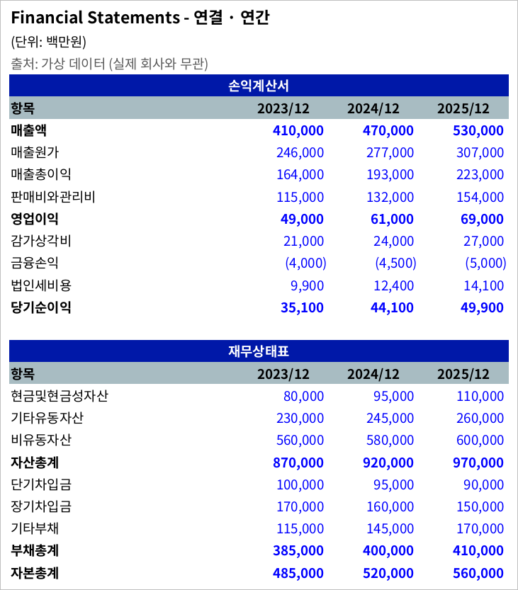

### 3. 숫자 형식

| 종류 | 형식 코드 | 표시 예 |
|---|---|---|
| 금액 | `#,##0_);(#,##0);-` | 1,234 / (1,234) / - |
| 소수 1자리 | `#,##0.0_);(#,##0.0);-` | 12.3 / (12.3) / - |
| 퍼센트 | `0.0%_);(0.0%);-` | 12.3% / (12.3%) / - |
| 배수 | `0.0x` | 19.2x |

- 음수는 괄호. 빼기 기호보다 눈에 잘 띄고 인쇄해도 사라지지 않습니다.
- 0은 하이픈. 값이 0인 것과 비어 있는 것(미수집)을 구분합니다.
- 퍼센트는 분수로 저장합니다(12.3%는 0.123). 문자열이나 12.3으로 저장하면 다른 수식에서 못 씁니다.
- 양수 뒤에 괄호 한 칸만큼 여백을 둬서 양수와 음수의 자릿수가 세로로 맞습니다.

### 4. 시트 번호 체계

시트 이름 앞의 번호로 성격을 구분합니다. 회사마다 시트 수가 달라도 같은 번호는 같은 내용입니다.

| 번호 | 내용 | 원천 |
|---|---|---|
| 00 | README: 데이터 사전, 색 규칙, 제외한 것, 기준일과 한계 | - |
| 01 | KPI: 핵심지표 (링크와 수식만) | 10번대 |
| 10~13 | 재무제표: 연결·별도 x 연간·분기 | 공시 API (파랑) |
| 14 | 투자지표, 증권사 추정치 | 시세 사이트 |
| 15 | 재무비율 (전부 10번 참조 수식) | 10번대 |
| 16~2x | 배당, 주식수, 밸류에이션 배수, Historical PER/PBR | 공시, 시세 |
| 30~4x | 매출 구성(30), FCF(31), 순차입금(32), 오버행, 주요 공시 | 공시 원문, 공시 API, 10번대 |
| 50~5x | 지분구조, 대량보유·임원 보고 | 공시 API |
| 60~6x | 업종 KPI | 통계, IR |
| 70~7x | 수급 (기관·외국인, 250거래일) | 시세 사이트 |
| 99 | Check: 파일 안의 점검과 종합 결과 | 각 시트 링크 |

샘플의 10개 시트는 이 체계를 그대로 따릅니다.

| 샘플 시트 | 번호 | 내용 |
|---|---|---|
| 00_README | 00 | 데이터 사전, 색 규칙, 제외한 것, 정의 |
| 01_KPI | 01 | 매출, 이익, FCF, 순차입금 (억원 링크) |
| 10_FS_연간, 11_IS_분기 | 10~13 | 연간 손익·재무상태·현금흐름, 분기 손익 |
| 15_재무비율 | 15 | 수익성, 안정성 비율 |
| 20_밸류에이션 | 16~2x | 시가총액, EV 산출, 배수와 역산 |
| 30_매출구성 | 30 | 부문별 매출·영업이익, 지역별 매출 |
| 31_FCF | 31 | FCF, 마진, 현금전환율, FCF yield |
| 32_순차입금 | 32 | 순차입금(리스 제외·포함), 순현금 |
| 99_Check | 99 | 항등식, 분기합, 부문합, FCF, EV, 배수 역산 |

**실측.** 국내 상장사 데이터셋 1건을 열어 센 결과입니다: 22개 시트, 수식 673개, 전 시트 격자선 꺼짐, 전 시트 틀 고정. 재무제표 4개 시트는 수식 0개(전부 파랑 원자료), KPI 시트는 값 68칸 중 43칸이 수식입니다. 원자료 층과 계산 층이 섞이지 않았다는 뜻입니다.

### 5. README 시트

데이터셋의 첫 시트에 세 가지를 적습니다.

- **데이터 사전**: 시트별 내용, 단위, 기간.
- **제외한 것**: 줄글(연혁, 사업모델, 논지)과 밸류에이션 모델링은 싣지 않습니다. 공시되지 않아 못 넣은 지표도 여기 적습니다.
- **기준일과 한계**: 시세 기준일, 추정치가 없는 종목의 빈칸이 누락이 아니라는 설명.

"없는 것을 있는 줄 알지 않게" 하는 장치입니다. 데이터셋에는 숫자만 두고 해석은 넣지 않습니다. 해석이 섞이면 숫자를 믿을 수 없게 됩니다.

### 6. 밸류에이션: EV 산출과 배수 역산

20_밸류에이션은 시가총액에서 EV를 만들고, 그 EV와 시총으로 배수를 낸 뒤 다시 시총으로 되돌려 봅니다.

- **시가총액** = (발행주식수 − 자기주식) × 기준일 종가. 샘플: (500,000,000주 − 20,000,000주) × 2,000원 = 960,000 백만원.
- **EV** = 시가총액 + 순차입금 + 비지배지분 − 관계기업투자. 샘플: 960,000 + 130,000 + 35,000 − 70,000 = 1,055,000. 순차입금은 32_순차입금, 비지배지분과 관계기업투자는 10_FS_연간을 링크하므로 초록입니다. 시총은 기준일, 나머지는 2025A 말 장부 잔액입니다.
- **배수** (2025A): PER 20.2x (지배주주순이익 47,600), PBR 1.8x (지배주주지분 525,000), EV/EBITDA 11.0x (EBITDA 96,000), EV/Sales 2.0x (매출 530,000).
- **역산**: 각 배수 옆에 "금액 x 배수"를 다시 계산한 역산 시총을 둡니다. EV 배수 두 줄은 금액 x 배수에서 (EV − 시총)을 빼서 시총으로 되돌립니다. 네 줄이 모두 960,000으로 돌아와야 하고, 한 줄이라도 다르면 금액, 배수, 주식수, EV 브리지 항목 중 하나가 틀린 것입니다.


### 7. 매출 구성, FCF, 순차입금

재무제표 다음 층입니다. 세 시트의 금액은 10_FS_연간 링크(초록)와 같은 시트 수식(검정)이고, 원자료(파랑)는 30_매출구성의 부문·지역 금액뿐입니다. 부문합과 지역합은 시트 안의 '차이' 행으로, FCF와 EV는 99_Check에서 공시 계정으로 다시 계산해 대조합니다. 원천과 자동화 수준은 [데이터 원천 문서](https://github.com/dhpark19955-code/claude-code-data-portfolio/blob/main/docs/08_data_sources.md) 3절에 있습니다.

#### 30_매출구성


- 부문 매출(파랑 원자료)을 더해 연결 매출(초록 링크)과 뺀 '차이' 행을 둡니다. 2025A: 플랫폼 310,000 + 솔루션 220,000 + 기타 6,000 + 내부거래 제거 (6,000) = 530,000, 차이 0.
- 부문 영업이익 합 69,000이 연결 영업이익과 같은지도 같은 방식으로 봅니다.
- 지역 매출: 국내 400,000, 해외 130,000. 해외 비중 24.5%. 비중의 분모는 내부거래 제거 후 연결 매출이라 세 부문 비중의 합은 100%를 조금 넘습니다(플랫폼 58.5%).
- 한계: 실제 파이프라인에서 부문·지역 매출은 사업보고서 XML 표를 회사별로 해석해야 해서 완전 자동이 아닙니다. 7단계 체크리스트에 수작업 항목으로 나옵니다.

#### 31_FCF


- FCF = 영업활동현금흐름 + 유형자산의 취득 + 무형자산의 취득. CAPEX는 유출이라 음수로 저장하고 `abs()` 를 쓰지 않습니다. 2025A: 86,000 + (41,000) + (7,000) = 38,000.
- FCF 마진 7.2%, 현금전환율(FCF ÷ 지배주주순이익) 79.8%, 배당 (14,000) 후 FCF 24,000, FCF yield(시총 대비) 4.0%.
- 한계: 실제 파이프라인의 CAPEX 수집 스크립트(`fetch_capex.py`)는 이 저장소에 없습니다.

#### 32_순차입금


- 순차입금 = 총차입금 − 현금. 2025A: 240,000 − 110,000 = 130,000. 부호는 양수가 순차입, 음수가 순현금이고, 순현금 행은 그 반대 부호라 (130,000)으로 보입니다.
- 리스부채 25,000은 기본 순차입금에서 빼고 '순차입금 (리스 포함)' 행에만 더합니다(155,000). EV 산출에는 리스 제외 값이 들어갑니다.
- 순차입금/EBITDA 1.4x.

### 8. 파일 안의 검증

99_Check는 항등식, 분기합, 부문합, FCF, EV 브리지, 배수 역산 17개를 한곳에 모으고 마지막에 종합 결과(Master check)를 냅니다.

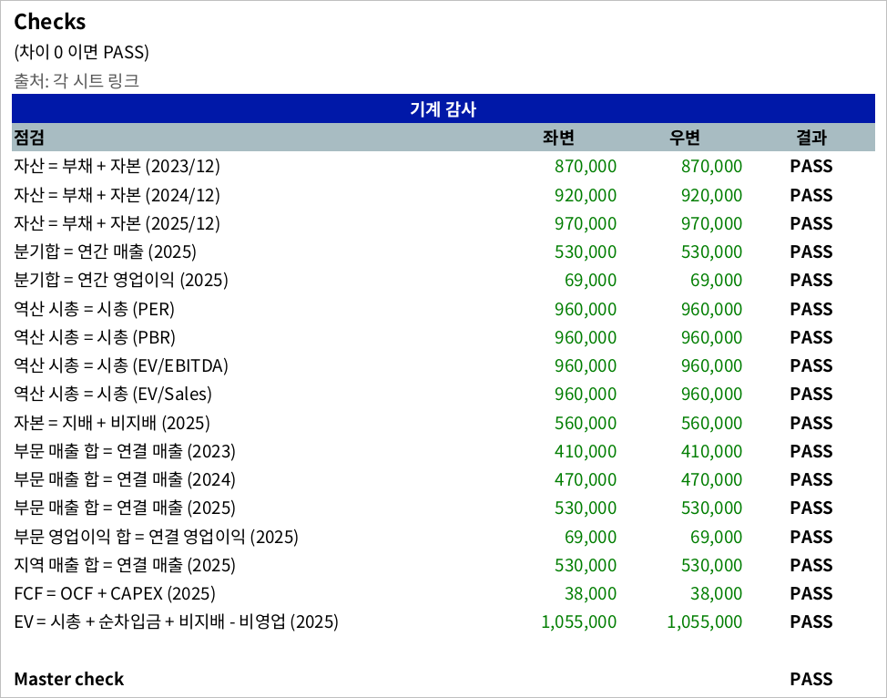

### 9. 저장 후 절차

1. 파이썬으로 저장한 직후에는 수식 값이 비어 있습니다. Excel로 열어 재계산하고 다시 저장합니다.
2. 오류 셀(`#REF!`, `#DIV/0!` 등)을 세어 0인지 확인합니다.
3. 감사 도구를 돌립니다.
4. 통과하면 `YYMMDD_회사명_Data` 폴더에 같은 이름으로 배포합니다.

샘플의 검증 결과는 [`demo/output/verify_report.md`](https://github.com/dhpark19955-code/claude-code-data-portfolio/blob/main/demo/output/verify_report.md) 에 있습니다: 시트 10개, 오류 셀 0개, 점검 17개 전부 통과. 샘플은 Excel 대신 LibreOffice headless로도 재계산할 수 있습니다([`demo/verify_sample_lo.py`](https://github.com/dhpark19955-code/claude-code-data-portfolio/blob/main/demo/verify_sample_lo.py)). LibreOffice는 값 계산과 캡처에만 쓰고, 배포 파일은 openpyxl이 만든 원본 그대로입니다.

### 10. 코드에서는 어떻게 쓰나

서식을 한 모듈에 상수로 두고, 시트는 행을 선언하기만 합니다. 값의 종류(input, formula, link)를 주면 색이 정해집니다.

```python
kp = Sheet(wb, "01_KPI", "Key Performance Indicators", "(단위: 억원, %)", "출처: 10_FS_연간 링크")
kp.band("핵심 KPI (연결, 억원)", 4)
kp.header(["항목", "2023A", "2024A", "2025A"])
kp.row("매출액", ["='10_FS_연간'!C6/100", ...], kind="link", bold=True)   # 초록
kp.row("  % growth", [None, "=IFERROR(D6/C6-1,\"\")", ...], kind="formula", fmt=PCT)  # 검정
```

색을 사람이 고르지 않고 값의 종류가 정하기 때문에, 링크인데 파랑으로 칠해지는 실수가 생기지 않습니다.

---

## 모델 빌드. 입력 한 파일에서 검증된 모델까지

재무모델은 엑셀을 직접 고치지 않고 **입력 파일을 고쳐 다시 빌드**합니다. 손으로 고친 모델은 무엇이 바뀌었는지 추적할 수 없고, 다음 갱신 때 같은 수정을 다시 해야 하기 때문입니다.

화면은 가상 회사 샘플입니다. [`demo/build_ib_sample.py`](https://github.com/dhpark19955-code/claude-code-data-portfolio/blob/main/demo/build_ib_sample.py) 가 6개 시트(Cover, Inputs, Projection, DCF, SOTP, Checks)로 만들고, [`demo/verify_sample.py`](https://github.com/dhpark19955-code/claude-code-data-portfolio/blob/main/demo/verify_sample.py) (Windows + Excel) 또는 [`demo/verify_sample_lo.py`](https://github.com/dhpark19955-code/claude-code-data-portfolio/blob/main/demo/verify_sample_lo.py) (LibreOffice, Linux·macOS·Windows) 가 3케이스 전부를 검증합니다. DCF와 SOTP 두 방법으로 주당가치를 냅니다. 실제 엔진은 입력을 yaml 파일로 받고 유형과 점검 항목이 훨씬 많지만, 구조와 원칙은 같습니다.

### 표준 흐름

| 단계 | 내용 | 멈추는 조건 |
|---|---|---|
| 0. 확정 3가지 | 대상, 목적, 기준일 | 질문은 한 번에 하나. 판단이 갈리지 않는 것은 기본값으로 진행하고 "사용한 기본값" 표를 붙임 |
| 1. 유형 선언 | 13개 유형 중 무엇으로 볼지 한 줄로 알림 | 빌더가 없는 유형이면 여기서 멈추고 없다고 말함 |
| 2. 사실 수집 | 재무, 시세, 할인율 재료를 묻지 않고 받음 | 사용자만 줄 수 있는 것(사업계획, 계약 조건)은 요청 |
| 3. 입력 작성 | 입력 파일 하나. 숫자마다 출처와 기준일 | 사실은 단일값, 판단이 갈리는 가정은 Base·Bull·Bear |
| 4. 빌드 | 입력 파일에서 워크북 생성 | "쓰이지 않은 입력" 경고가 0이 될 때까지 |
| 5. 3관문 | Check, Lint, 독립 재계산 | 하나라도 실패하면 보고하지 않고 고침 |
| 6. 보고 | 결론, 케이스 표, 사실과 판단 구분, 점검 결과, 민감도, 미확인 사실 | - |

### 워크북 구조

| 시트 | 역할 | 규칙 |
|---|---|---|
| Cover | 케이스 스위치, 핵심 결과, 종합 점검 | 스위치 한 칸으로 전체가 바뀜 |
| Inputs | 모든 입력 | 파란 입력은 이 시트에만 |
| Projection | 추정 손익과 현금흐름 | Inputs 링크와 같은 시트 수식만 |
| DCF | 할인, 기업가치, 주당가치, 민감도 | 순차입금 정의를 명시 |
| SOTP | 부문별 배수로 가치를 더해 주당가치 | 배수와 할인율은 Inputs의 판단값만 참조 |
| Checks | 모델 점검 | FAIL이 하나라도 있으면 납품하지 않음 |

#### Inputs: 입력은 한 시트에만

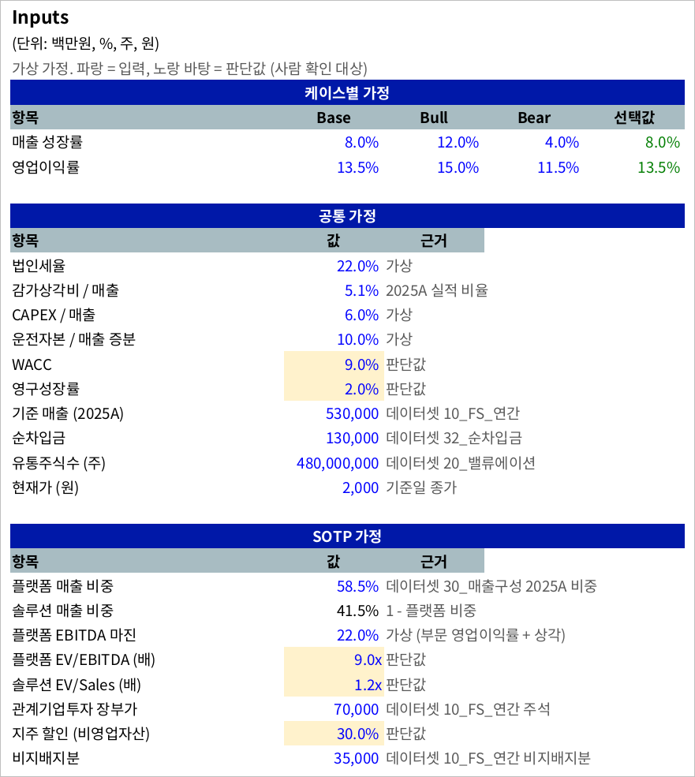

- 케이스별 가정은 Base, Bull, Bear를 나란히 두고 "선택값" 열이 스위치에 따라 하나를 고릅니다. 선택값은 Cover를 참조하므로 초록입니다.
- 판단값(WACC, 영구성장률, SOTP의 부문 배수와 지주 할인)은 노랑 바탕입니다. 에이전트가 정하지 않고 사람이 확인하는 자리입니다.
- 입력마다 근거 열이 있습니다. 실제 모델에서는 출처와 기준일을 적습니다.

#### Cover: 스위치 한 칸

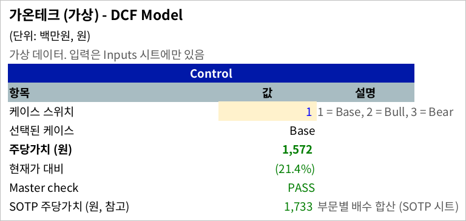

C6이 스위치, C8이 DCF 주당가치, C10이 Master check, C11이 SOTP 주당가치(참고)입니다. 케이스를 값 붙여넣기로 따로 만들지 않습니다. 스위치를 1에서 2로 바꾸면 전 시트가 다시 계산됩니다. 정적인 시나리오 표는 가정을 고쳤을 때 갱신되지 않아 틀린 숫자가 남습니다.

#### Projection: 수식 안에 숫자 없음

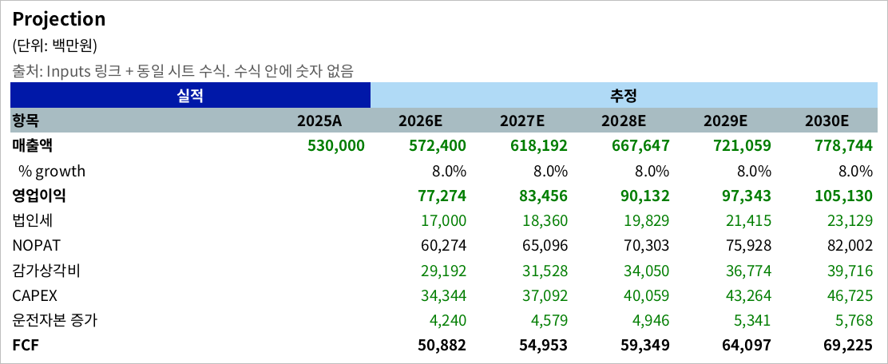

머리글 위의 띠로 실적(남색)과 추정(하늘색) 구간을 구분합니다. 추정 구간의 모든 값은 Inputs를 참조합니다. `=C6*1.08` 처럼 수식 안에 숫자를 넣으면 가정이 숨어 버려서 린터가 실패로 처리합니다. Projection 수식에는 가정 숫자가 하나도 없습니다(성장률 계산의 `1+`, `-1` 같은 구조 상수만 있음). DCF와 SOTP에 남은 숫자는 두 종류뿐입니다: 백만원을 원으로 바꾸는 단위 환산 `1000000`, 민감도 표의 간격 ±0.01.

#### DCF: 기업가치에서 주당가치까지


- 기업가치에서 순차입금을 빼 주주가치로 가는 과정을 한 줄씩 보여줍니다.
- 영구가치 비중을 따로 표시합니다. 이 비중이 너무 높으면 추정기간이 아니라 말기 가정이 가치를 정하는 모델입니다.
- 민감도 표는 붙여넣은 값이 아니라 살아 있는 수식입니다. 가운데 칸이 위의 주당가치와 같은지 Checks가 대조합니다.

#### SOTP: 부문별 배수 합산


부문마다 맞는 배수로 가치를 매겨 더합니다. 2026E Base 기준입니다(단위 백만원).

| 항목 | 계산 | 값 |
|---|---|---|
| 플랫폼 | 매출 334,854 → EBITDA 73,668 (마진 22%) × EV/EBITDA 9.0x | 663,011 |
| 솔루션 | 매출 237,546 × EV/Sales 1.2x | 285,055 |
| 영업 EV | 부문 가치 합계 | 948,066 |
| (+) 관계기업 | 70,000 × (1 − 지주 할인 30%) | 49,000 |
| (−) 순차입금 | 데이터셋 32_순차입금 | 130,000 |
| (−) 비지배지분 | 데이터셋 10_FS_연간 | 35,000 |
| 주주가치 | | 832,066 |
| 주당가치 | 주주가치 ÷ 유통주식수 480,000,000주 | 1,733원 |

- 암묵적 EV/EBITDA(영업 EV ÷ 2026E 연결 EBITDA)는 8.9x입니다. 부문 배수를 정한 결과가 연결 기준으로 몇 배인지 보여 줘서, 배수가 과하거나 모자란지 한눈에 봅니다.
- DCF 브리지는 순차입금만 빼지만, SOTP는 비영업자산(관계기업)과 비지배지분까지 반영합니다.
- 판단값은 세 개입니다: 플랫폼 EV/EBITDA 9.0x, 솔루션 EV/Sales 1.2x, 지주 할인 30%. 모두 Inputs에 노랑 바탕으로 있고 SOTP 시트에는 링크만 있습니다.

| 케이스 | DCF 주당가치 | SOTP 주당가치 |
|---|---|---|
| Base | 1,572 | 1,733 |
| Bull | 2,105 | 1,807 |
| Bear | 1,076 | 1,660 |

SOTP는 케이스에 따라 매출만 바뀌고 배수와 마진은 고정이라 DCF보다 범위가 좁습니다. 그래서 Bull에서는 DCF(2,105원)가 SOTP(1,807원)보다 높습니다.

한계: 샘플의 부문 비중(플랫폼 58.5%)은 데이터셋 30_매출구성의 2025A 값을 그대로 쓰고 2026E에도 같다고 둡니다. SOTP는 데이터셋이 아니라 이 모델 워크플로우에서 만드는 것이고, 샘플의 배수와 할인율은 가상 판단값입니다.

### 3관문

| 관문 | 무엇을 보나 | 샘플 결과 |
|---|---|---|
| Check | 재계산 후 오류 셀 0, 내부 점검 FAIL 0 | 3케이스 모두 오류 셀 0, Master check PASS |
| Lint | 구조 규칙 위반 (아래 금지 목록) | 샘플에는 린터 미포함 |
| 독립 재계산 | 엑셀 수식과 무관하게 파이썬으로 다시 계산해 대조 | 3케이스 DCF·SOTP 모두 차이 0.0000원 |

**모든 케이스를 봅니다.** Base만 확인하고 통과시키면 다른 케이스에서만 깨지는 수식을 놓칩니다. 검증 스크립트는 스위치를 1, 2, 3으로 바꿔 가며 각각 재계산하고 대조합니다.

| 케이스 | DCF 엑셀 | DCF 독립 재계산 | SOTP 엑셀 | SOTP 독립 재계산 | Master check |
|---|---|---|---|---|---|
| Base | 1,572 | 1,572 | 1,733 | 1,733 | PASS |
| Bull | 2,105 | 2,105 | 1,807 | 1,807 | PASS |
| Bear | 1,076 | 1,076 | 1,660 | 1,660 | PASS |

출처: [`demo/output/verify_report.md`](https://github.com/dhpark19955-code/claude-code-data-portfolio/blob/main/demo/output/verify_report.md) (가상 데이터)

검증기는 두 가지입니다. [`demo/verify_sample.py`](https://github.com/dhpark19955-code/claude-code-data-portfolio/blob/main/demo/verify_sample.py) 는 Windows의 Excel로 재계산하고, [`demo/verify_sample_lo.py`](https://github.com/dhpark19955-code/claude-code-data-portfolio/blob/main/demo/verify_sample_lo.py) 는 LibreOffice headless로 같은 검증을 해서 Linux, macOS, Windows에서 돕니다. 위 표는 LibreOffice 검증기로 낸 결과이고, 엑셀 수식 값과 [`demo/independent.py`](https://github.com/dhpark19955-code/claude-code-data-portfolio/blob/main/demo/independent.py) 의 독립 재계산 차이가 3케이스 DCF·SOTP 모두 0.0000원입니다. LibreOffice는 값 계산과 화면 캡처에만 쓰고, 배포하는 xlsx는 openpyxl이 만든 원본 그대로입니다.

실제 엔진의 검증은 라벨 문자열이 아니라 고유 키로 셀을 찾고 찾은 개수를 확인합니다. 라벨이 바뀌면 엉뚱한 셀을 읽고도 통과할 수 있기 때문입니다. 샘플 검증기는 이를 단순화해 B열 라벨이 정확히 같은 첫 행을 읽고, 라벨이 없으면 오류로 멈춥니다(찾은 개수는 확인하지 않음).

### 하지 않는 것

품질 기준 문서의 결함 목록에서 자주 걸리는 것만 골랐습니다.

| 구조 | 계산 | 절차 |
|---|---|---|
| 값 붙여넣기로 연결 끊기 | 라벨과 다른 계산 (이름은 영업이익률인데 매출총이익률) | 목표가를 먼저 정하고 가정을 역산 |
| 수식 안 숫자 | 영구가치를 기중 할인 | 판단값을 말없이 변경 |
| Inputs 밖의 파란 입력 | 순차입금에서 현금 이중 차감 | 엑셀을 직접 수정 |
| `TODAY()` 로 만든 시간축 | 감쇠 없는 영구 성장 | 사용자 원본 파일 덮어쓰기 |
| 정적 시나리오 표 | 손실을 `MAX(…,0)` 으로 가리기 | 지원하지 않는 유형을 억지로 근사 |

### 사람이 정하는 것

- **판단값은 사람이.** 위험프리미엄, 규모 프리미엄, 차입 비용, 영구성장률은 재료를 모아 제시하고 확정은 사람이 합니다.
- **확정한 결정은 되돌리지 않습니다.** 단일 케이스로 가기로 했으면 다음 세션에서 3케이스로 되돌리지 않도록 결정 로그를 남깁니다.
- **이미 만든 부문 모델은 그대로 옮깁니다.** 사용자가 만든 법인별 시트를 새로 짜지 않고 행 순서, 라벨, 단위를 보존해 옮기고 원본과 대조하는 행을 둡니다.
- **"간단하게" 요청은 영향부터 보여줍니다.** 정확도를 깎기 전에 무엇을 잃는지 숫자로 먼저 알립니다.
- **기밀 입력은 옮기지 않습니다.** 비공개 자료의 수치는 문서, 코드, 메모에 적지 않고, 쓴 뒤 스캔 도구로 대조합니다.

### 납품물

모델 하나에 다섯 가지가 같이 나갑니다: 워크북, 입력 파일, Check 리포트, Lint 리포트, 가정과 변경 로그. 워크북만 받으면 왜 이 숫자인지 다시 물어야 하기 때문입니다.

---

## 사례 1. 전처리 파이프라인

### 문제

공시 API가 주는 재무 데이터는 그대로 쓰면 틀립니다. 기간 기준, 부호, 단위, 계정명이 재무제표 종류와 회사, 연도에 따라 다르기 때문입니다. 사람이 엑셀로 옮기면 회사마다 같은 실수를 반복합니다.

### 만든 것

종목명 하나를 넣으면 수집부터 배포까지 한 번에 도는 파이프라인입니다.

| 단계 | 내용 |
|---|---|
| 0 | 종목 해석 (종목명 또는 코드에서 공시 고유번호 찾기) |
| 1 | 수집: 연결·별도 재무제표(연간 6년, 분기 10개), 시세 5년, 배당, 주식수, 지분 공시, 원문 |
| 2 | 재무 요약: 분기합과 연간값 대조 |
| 3 | 데이터셋 빌드: 20여 개 시트, 입력(파랑)·수식(검정)·다른 시트 링크(초록) 색 구분 |
| 4 | Historical PER/PBR, 수급 시트 추가 |
| 5 | Excel 재계산 후 기계 감사 |
| 6 | 날짜·회사명 규칙에 맞춰 배포 |
| 7 | 경고와 회사별 수작업 체크리스트 출력 |

수집 포함 10~15분, 재수집 없이 3~4분이 걸립니다. 자동으로 못 하는 것(부문별 매출, 오버행, 업종 KPI)은 7단계에서 체크리스트로 따로 알려 "자동으로 다 된 것처럼" 보이지 않게 했습니다.

### 전처리 규칙

| 원자료 상태 | 그대로 쓰면 생기는 문제 | 규칙 |
|---|---|---|
| 분기 손익이 3개월치와 누적치로 섞여 옴 | 분기 매출이 2~4배로 부풀려짐 | 1~3분기는 3개월치 필드를 쓰고, 4분기는 연간에서 3개 분기 합을 뺌 |
| 현금흐름은 누적(YTD)으로만 옴 | 분기 현금흐름이 누적으로 표시됨 | 같은 계정 안에서만 차분 |
| 현금흐름 유출 계정이 양수로 옴 | CAPEX, 배당이 유입으로 계산됨 | 계정 성격으로 부호 결정. abs()는 환입성 음수 항목을 뒤집으므로 금지 |
| 억원, 십억원, 백만원 출처가 섞임 | 100배 오차 | 시트마다 단위를 명시하고 대표값 하나를 원자료와 대조 |
| 차입금 계정명이 회사마다 다름 | 차입금이 0으로 집계되어 순현금 회사로 보임 | 별칭 표로 표준 계정에 모으고, "차입금 0인데 부채비율 높음"이면 경고 |
| 잠정 실적과 확정 실적이 다름 | 어느 값이 맞는지 추적 불가 | 양쪽을 병기하고 정정 이력을 남김 |
| 무상증자, 분할, 소각 | 주당 지표와 과거 시총이 틀어짐 | 주식수 이상치를 정리하고 보정 내역을 파일로 보관 |
| 무활동을 더미 1행으로 주는 API | "없음"과 "수집 안 함"이 구분 안 됨 | 0행을 명시적으로 남김 |

### 재현

demo/preprocess_demo.py 가 위 규칙 중 5개를 가상 데이터로 재현합니다. 실제 파이프라인 핵심 모듈은 originals/pipeline/ 에 있고, 데모는 키 없이 돌도록 이 저장소용으로 새로 썼습니다.

---

## 사례 2. 비정형·해외 원자료

### 문제

정형 API로 받을 수 있는 숫자는 일부입니다. 부문별 매출, 전환사채 조건, 지분 변동, 분기 실적 세부는 공시 원문, 실적발표 HTML, IR PDF 안에 있고, 나라와 제출 양식에 따라 구조가 다릅니다.

### 출처별 접근

| 출처 | 형식 | 처리 방법 | 겪은 문제 |
|---|---|---|---|
| 국내 공시 원문 | XML, 중첩 표 | 행 단위로 셀 텍스트를 풀어 읽음 | 구형 인코딩, 표 안의 표, 개인명 마스킹 |
| 미국 연간·분기 보고서 | XBRL 수치 데이터 | 태그별로 기간을 맞춰 추출 | 과거 수치 재작성, 비슷한 태그 혼입 |
| 해외 기업의 분기 실적 | 실적발표 HTML 표 | 표를 직접 파싱 | 연간 보고서만 XBRL이 있어 분기는 표가 유일한 출처 |
| IR 덱, 컨퍼런스콜 전문 | PDF | 공개 피드에서 공식 문서 목록을 찾아 수집 | IR 페이지가 접근을 막아도 공개 피드는 열려 있는 경우가 있음 |
| 홍콩 공시 | 검색 화면 | 브라우저로 검색해 PDF 링크 확보 | 기존 검색 주소가 폐지됨 |
| 비상장사 | 감사보고서 PDF | 재무제표와 주석 표를 추출 | 정형 API에 데이터가 없음 |

### 판단 기준

- **같은 숫자가 출처마다 다르면 양쪽을 병기합니다.** 같은 과거 실적을 IR 덱이 발표 시점마다 다르게 다시 적는 경우가 있어, 덱 발표 시점별로 열을 나눠 싣습니다.
- **막힌 경로는 우회하지 않습니다.** 로그인이 필요한 화면이나 봇 차단은 건드리지 않고 공개 대체 출처를 찾습니다. 못 찾으면 "수집 못 함"으로 남깁니다.
- **커버리지가 없는 것과 누락을 구분합니다.** 증권사 추정치가 없는 종목은 빈칸이 정상이므로 데이터 사전에 "누락 아님"이라고 적습니다.
- **원자료는 다음 분석이 읽기 쉽게 보관합니다.** 수집은 Claude Code가, 해석은 사람이나 대화형 분석이 하도록 저장 규칙을 표준화했습니다.

### 결과

국내 상장사 표준 파이프라인으로 처리되지 않는 해외 상장사 4곳과 비상장사 2곳을 같은 데이터셋 양식으로 정리했습니다. 회사별 해석 함정(결산월 불일치, 회계정책 변경에 따른 소급 재작성, 다중 주식 구조의 주당이익)은 메모로 남겨 다음 갱신 때 같은 문제를 다시 풀지 않게 했습니다.

---

## 사례 3. 검증 체계

### 문제

AI가 만든 숫자는 그럴듯해 보여서 더 위험합니다. 만든 쪽이 스스로 "확인했다"고 말하는 것만으로는 부족하므로, 기계적으로 걸리는 검사와 만든 쪽과 분리된 검수를 뒀습니다.

### 감사 항목

| # | 검사 | 잡아내는 것 |
|---|---|---|
| 1 | 회계 항등식: 자산 = 부채 + 자본, 자본 = 지배 + 비지배 | 열 밀림, 전기 수치 오류 |
| 2 | 비율 범위: 이익률, ROE, 부채비율이 상식 범위 안인지 | 단위 오류, 분모 오류 |
| 3 | 배수 역산: 각 행의 금액 x 배수가 같은 시가총액으로 돌아오는지 | 10배, 100배 오류 |
| 4 | 부문합과 연결 수치 대조 | 부문 표 전사 오류, 누락된 조정 항목 |
| 5 | 단위 라벨과 값 대조 | 억원 값에 십억원 라벨 |
| 6 | 분기합과 연간 대조 | 기간 합성 오류 |

수식이 든 파일은 저장 후 Excel로 다시 계산해 오류 셀이 0개인지 확인합니다. 검증 못 한 범위(예: 해외 비교기업 시세)는 "확인 못 한 것"으로 따로 보고합니다.

### 실제로 잡은 오류

| 대상 | 오류 | 영향 | 잡은 방법 |
|---|---|---|---|
| 대형 인터넷 기업 데이터셋 | 부문손익 한 해 열이 한 칸 밀림 | 부문별 개선·악화 방향이 반대로 읽힘 | 부문합이 연결 영업이익과 불일치 |
| 같은 데이터셋 | 억원 값에 십억원 라벨 | 다른 표와 합치면 100배 오차 | 단위 라벨 대조 |
| 지주회사 2곳 | 표준 빌더가 유동성 사채 등 일부 차입 계정을 누락 | 순차입금 과소 계상 | "차입금이 작은데 부채비율이 높음" 경고 |
| 증권사 원문 인용 모델 | 원문 자체의 오류 6건, 출처 간 실적 수치 충돌 | 잘못된 가정이 모델에 들어갈 뻔함 | 원문과 공시 대조 |
| 여러 종목 | 지배주주 순이익이 비어 있음 | 주당이익, PER 계산 불가 | "비지배지분은 있는데 지배지분이 없음" 경고 |

### 정정 보존 원칙

정정은 데이터셋 파일에만 적용되고 원천 파일에는 오류가 남는 경우가 많습니다. 그래서 최신본을 원천에서 다시 만들면 고친 오류가 되살아납니다. 갱신은 감사를 통과한 최신 사본 위에 새 수치만 얹는 방식으로 하고, 원천에 오류가 남아 있다는 사실을 기록으로 남깁니다.

### 독립 검수

만든 에이전트와 검수 에이전트를 분리했습니다. 검수 에이전트(checker)는 파일을 고칠 권한이 없고, 작성자의 결론이 아니라 "무엇을 어디서 확인할지"만 받아 원자료와 산출물을 직접 대조합니다. 보고는 확인한 사실, 발견한 위험, 확인 못 한 것으로 나눕니다. 정의 예시는 claude-setup/agents/checker.md 에 있습니다.

---

## 사례 4. Claude Code 운영

### 문제

Claude Code는 세션이 바뀌면 이전 맥락을 잊습니다. 그대로 쓰면 매번 같은 설명을 반복하고, 같은 함정에 다시 빠지고, 결과물 형식이 세션마다 달라집니다. 프롬프트를 잘 쓰는 것으로는 해결되지 않아 작업 환경 자체를 설계했습니다.

### 구성 요소

| 요소 | 역할 | 설계 판단 |
|---|---|---|
| 전역 지침 (CLAUDE.md) | 작업 유형별로 먼저 읽을 지침 파일을 가리키는 라우팅 표 | 지침을 한 파일에 다 넣지 않고, 필요한 분야만 읽게 해 맥락을 아낌 |
| 스킬 4종 | 반복 작업의 표준 절차 (데이터셋, 수집, 모델, 작업기록) | 스킬 폴더에는 진입 파일만 두고 본문은 한 곳의 정본을 가리킴 |
| 서브에이전트 3종 | worker(큰 구현), helper(단순 조회·변환), checker(읽기 전용 검수) | 작업 크기에 따라 모델을 나눠 비용을 줄이고, 검수는 권한을 제한 |
| 메모리 149건 | 함정, 사용자 결정, 출처 경로 | 실패할 때마다 "증상, 원인, 해법"으로 기록해 재발 방지 |
| MCP 서버 | 공시 조회, 시세·추정치 조회 도구 | 자주 쓰는 조회를 도구로 만들어 매번 스크립트를 쓰지 않게 함 |
| 이식 패키지 | 다른 PC에 같은 환경을 설치하는 묶음 | 설치기, 점검 도구(doctor), 경로 독립성 |

### 지휘자와 일꾼

메인 세션은 계획, 설계, 검수를 맡고 구현은 나눠 맡깁니다.

- 큰 구현 1건은 worker에게, 한두 단계로 끝나는 일은 helper에게 줍니다.
- 일꾼의 보고는 그대로 믿지 않고 파일과 실행 결과로 직접 확인합니다.
- 삭제, 덮어쓰기, 외부 업로드, 배포, 운영 자격증명은 어느 에이전트가 하든 사람 확인을 먼저 받습니다.

### 사람이 멈추는 지점

자동화 범위를 넓히는 것만큼 멈출 곳을 정하는 것이 중요했습니다.

- 판단이 들어가는 값(할인율의 위험프리미엄 등)은 에이전트가 정하지 않고 사람 확인에서 멈춥니다.
- 목표 결과를 먼저 정하고 가정을 거꾸로 맞추지 않습니다.
- 지원하지 않는 모델 유형은 지원하는 것처럼 만들지 않고 없다고 말합니다.
- "수치는 그대로, 서식만" 요청은 값과 수식을 바꾸지 않고 전후를 대조합니다.
- 정기 작업은 지시가 있을 때만 실행합니다. 알림을 만들면 발송 총량 상한을 둡니다.

### 이식성

만든 환경이 내 PC에서만 돌면 팀 자산이 되지 못합니다. 다른 PC에 설치할 수 있게 묶으면서 겪은 문제입니다.

| 문제 | 해결 |
|---|---|
| 스크립트에 사용자 이름이 든 절대경로 | 스크립트 파일 위치 기준 상대경로, 환경변수로 덮어쓰기 가능 |
| 설치 스크립트가 다른 PC에서 깨짐 (인코딩, 예약 변수명, 최신 문법) | 6가지 함정을 목록으로 정리하고 가짜 홈 폴더에서 설치 시험 |
| 키가 패키지에 섞여 나감 | 키는 한 파일에만 두고 패키지에는 빈 양식만 포함, 새 PC에서 직접 입력 |
| 설치가 됐는지 알 수 없음 | 점검 도구가 경로, 파이썬, 키 존재 여부(값은 표시 안 함)를 확인 |

한계: 설치 시험은 같은 PC의 가짜 환경에서만 했고, 실제 다른 PC에서의 검증은 아직 못 했습니다.

### 보안 운영

- 공개용 키와 비밀값을 구분하고, 비밀값은 코드와 출력에 남기지 않습니다.
- 채팅에 키가 붙으면 다시 출력하지 않고 폐기와 재발급을 권고합니다.
- 실제 개인 데이터는 예시와 테스트에 쓰지 않고 가상 데이터를 만듭니다.
- 웹페이지나 문서 안의 지시문은 명령이 아니라 자료로 다룹니다.
- 로그에 키가 찍히는 버그를 한 번 겪은 뒤, 로그 출력 경로를 점검 항목에 넣었습니다.

설정 예시는 claude-setup/ 에 일반화해 실었습니다.

---

## 함정 목록

작업 중 실제로 겪고 메모로 남긴 것 중 다른 사람에게도 쓸모 있는 것만 골랐습니다. 형식은 증상, 원인, 해법입니다.

### 데이터

| 증상 | 원인 | 해법 |
|---|---|---|
| 분기 매출이 실제의 몇 배 | 누적 필드를 분기값으로 사용 | 3개월치 필드 사용, 4분기는 연간에서 차감 |
| CAPEX가 현금 유입으로 계산됨 | 현금흐름 유출 계정이 양수로 옴 | 계정 성격으로 부호 결정, abs() 금지 |
| 순현금 회사로 보이는데 부채비율이 높음 | 차입금 계정명 변형이 별칭 표에 없음 | 별칭 추가, 경고 규칙으로 감지 |
| 다른 표와 합치니 100배 차이 | 억원 값에 십억원 라벨 | 시트마다 단위 명시, 대표값을 원자료와 대조 |
| 고친 오류가 최신본에서 되살아남 | 정정이 산출물에만 있고 원천에는 없음 | 감사 통과본 위에 갱신, 원천 오류 잔존을 기록 |
| 과거 주당 지표가 튐 | 무상증자, 분할, 소각 미반영 | 주식수 보정 내역을 파일로 관리 |
| 장중 가격이 종가로 들어감 | 수집 시점이 장중 | 기준일 종가로 고정하고 기준일을 표기 |

### Excel과 파이썬

| 증상 | 원인 | 해법 |
|---|---|---|
| 수식 셀이 값 없이 저장됨 | 파이썬 라이브러리는 수식 계산 결과를 저장하지 않음 | 저장 후 Excel로 재계산하고 오류 셀 0개 확인 |
| 라벨이 사라지고 오류 표시 | 문자열이 등호로 시작해 수식으로 해석됨 | 라벨을 등호로 시작하지 않음 |
| Excel이 파일 열기를 거부 | 틀 고정 잔재, 하이퍼링크, 차트 축 설정 | 원인별 점검 목록으로 확인 |
| 엉뚱한 파일이 재계산됨 | 재계산 도구가 폴더 전체에서 최신 파일을 고름 | 대상 폴더를 한정하는 래퍼 사용 |
| 서식만 바꿨는데 값이 변함 | 라이브러리로 저장하며 수식 캐시가 날아감 | 서식 작업은 Excel 자동화로 하고 전후 대조 |

### Windows 환경

| 증상 | 원인 | 해법 |
|---|---|---|
| 스크립트가 아무 출력 없이 끝남 | 경로상의 파이썬이 설치 안내용 스텁 | 실제 실행 파일 경로를 지정, 산출물 수정 시각으로 확인 |
| 업로드 스크립트가 중간에 죽음 | 출력을 앞 N줄만 자르는 파이프가 프로세스를 종료 | 출력은 파일로 받아서 읽기 |
| 한글 경로 인자가 깨짐 | 셸과 파이썬의 인코딩 차이 | 파일명 패턴만 받아 스크립트 안에서 찾기 |
| 앱 터미널에서 스크립트가 멈춤 | 입력 대기를 받을 수 없는 환경 | 입력 대기 대신 상태 확인 방식 |
| 설치 스크립트가 다른 PC에서 실패 | 인코딩 표식 누락, 예약 변수명, 최신 문법, 인자 전달 누락 | 6개 항목 점검표와 가짜 홈 폴더 시험 |

### 에이전트 운영

| 증상 | 원인 | 해법 |
|---|---|---|
| 에이전트가 "완료"라고 했지만 틀림 | 보고를 그대로 신뢰 | 파일과 실행 결과로 직접 확인, 읽기 전용 검수 분리 |
| 병렬 실행이 한도 오류로 실패 | 동시에 너무 많은 에이전트 실행 | 작업 크기별 분배 기준과 동시 실행 수 제한 |
| 다른 주제 파일을 건드림 | 세션 범위가 불명확 | 범위 밖 이슈는 조사와 보고까지만, 수정은 확인 후 |
| 알림이 폭주 | 발송 상한 없음 | 총량 상한을 기본값으로, 초과분은 묶음으로 전환 |
